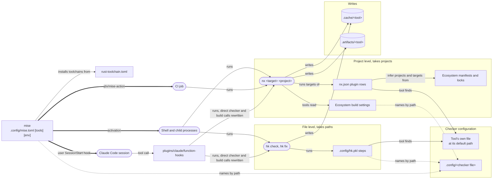

# [RASM]

Rasm is a polyglot monorepo with macOS-first development and portable code and tooling for Linux and Windows.

## [01]-[LAYOUT]

Folders name categories down to a project, the first folder holding a manifest, and folders inside a project group its own concepts:

```text
Rasm/
├── products/
│   ├── apps/                 # Projects based on other vendors' applications
│   ├── developer/
│   ├── ai/
│   ├── macos/
│   ├── cli/
│   └── web/
├── libs/                     # Packages by language, then category
│   ├── cpp/
│   ├── dotnet/
│   ├── python/
│   ├── rust/
│   ├── swift/
│   └── typescript/
├── tests/                    # Suites by the category of what they test
│   ├── products/
│   ├── libs/
│   ├── plugins/
│   ├── tools/
│   ├── e2e/                  # Suites against a served or installed product
│   └── support/              # Test harnesses by language
├── tools/                    # Checks and grammars other checkers lack
│   ├── ast-grep/             # Grammars and rules per language
│   ├── conformance/          # Nx project graph and workspace files
│   ├── dylint/               # Rust
│   └── refurb/               # Python
├── assets/                   # Repo submodule with reusable assets no product owns
├── infra/                    # Pulumi programs for the repository, machines, and hosting
├── plugins/                  # Agent harness plugins, shared or per host
├── docs/
├── nx.json                   # Nx plugins, release, and conformance
├── package.json              # TypeScript
├── pnpm-workspace.yaml       # TypeScript workspace and central package catalog
├── tsconfig.*                # TypeScript
├── vitest.config.ts          # TypeScript
├── .oxlintrc.json            # TypeScript and JavaScript
├── .oxfmtrc.json             # TypeScript, JavaScript, and data files
├── pyproject.toml            # Python workspace and central package catalog
├── Workspace.slnx            # .NET workspace
├── global.json               # .NET
├── Directory.Packages.props  # .NET central package catalog
├── Directory.Build.props     # .NET
├── Directory.Build.targets   # .NET
├── NuGet.config              # .NET
├── Package.swift             # Swift workspace and central package catalog
├── Xcode.xcconfig            # Swift
├── Cargo.toml                # Rust workspace and central package catalog
├── rust-toolchain.toml       # Rust
├── .cargo/                   # Rust
├── CMakeLists.txt            # C++ workspace
├── CMakePresets.json         # C++
├── vcpkg.json                # C++ central package catalog
├── sgconfig.yml              # ast-grep
├── .editorconfig
├── .github/
├── .config/                  # Tool configuration
├── .claude/
├── .claude-plugin/           # Claude Code marketplace of plugins/
├── .codex/
├── .agents/                  # Codex marketplace of plugins/
├── .vscode/
├── CLAUDE.md                 # Agent standards, linked as AGENTS.md
├── LICENSE
└── README.md
```

## [02]-[FLOW]

Thick arrows supply tools and variables, solid arrows run, read, or write, and dotted arrows name a file by path:



## [03]-[PRINCIPLES]

- Each fact sits once in the file its tool reads, and every other use derives it
- Tool behavior comes from its source and docs at the installed version, and configuration sets only what departs from it
- Each ecosystem pins every version, root tooling included, in its root catalog and lock, and targets build from the committed lock
- Tools read configuration from `.config/` where a setting names its path, else from their fixed path, and checkers report every finding as an error
- `hk` runs `.config/hk.pkl` steps over paths a shell or agent names and over commit messages, Nx runs project-level work, and neither calls the other

## [04]-[NX]

Nx runs project-level work over a graph its plugins infer:
- Plugins use what Nx and its official plugins provide, and behavior an `nx.json` field or plugin option can state stays out of plugin code
- Plugins infer every project, target, and dependency from manifests and tool output, manifest `nx` tables adding only facts no tool reports
- `nx affected` runs only the tasks a change reaches, as each target's inputs name exactly what its tools read, aggregate targets included
- Tools keep their own incremental state, and Nx caches results around it in one remote cache every runner shares, so hashes hold no machine path
- `nx conformance:check` runs the `nx.json` conformance rules, which hold the graph and every target to these principles

`nx <target> <project>` runs one project and `nx affected -t <target>` a change's reach, each target one operation in every ecosystem:
- `codegen` writes source a project's tools derive from its schemas and configuration
- `build` compiles or packages a project into its declared outputs
- `check` reports findings of checkers reading the project model
- `fix` applies fixes from checkers reading the project model
- `test` runs a project's test runners
- `serve` runs a project's development servers until the run ends, and starts the Compose services it holds, which stay up
- `preview` builds a project, then serves its build output as `serve` does
- `upgrade` moves an ecosystem root's dependency requirements and locks to newer releases through its own tool
- `clean` removes the outputs a project's targets declare and runs its tool's clean

## [05]-[COMMANDS]

Workspace commands, by tool:
- `hk check <paths>` and `hk fix <paths>` run every file-level checker and writer over the named paths
- `mise bootstrap` after a clone installs mise tools, pnpm packages, the MSBuild analyzer, and hk's git hooks, and registers pitchfork as a Mac login agent
- `mise deps` syncs pnpm packages and each uv root, the workspace root through Pixi, and publishes the MSBuild analyzer `@rasm/nx-dotnet` runs, where inputs changed or outputs are missing
- `mise upgrade`, after `nx run-many -t upgrade`, moves every `latest` tool row and its lock to the newest release, then `mise prune` deletes each installed version no tracked config selects
- `mise daemons start docker` starts the container engine and waits until Docker answers, `mise daemons stop docker` stops it until a session enters
- `nx build @rasm/nx-apple-darwin-arm64` builds the core `@rasm/nx-apple` reads Xcode projects through, on a Mac after a clone
- `nx sync` writes executor schemas and tsconfig `references`
- `nx migrate <version>`, then `nx migrate --run-migrations`, applies a new Nx release's migrations, and `pnpm dedupe` moves peer ranges the lock held
- `pixi run --locked python` supplies the library search path for `magic` and `weasyprint`

## [06]-[TESTING]

Suites sit in `tests/` except where their tool fixes the place, and run on every platform their toolchain allows:
- Suites stay inside a nested tool root that stops discovery at its root (SwiftPM analyzer, Blender uv root) or a plugin folder published whole
- Logic needing no host sits in projects tested on every platform, and tag `os:<platform>` marks only projects a toolchain or target framework limits
- C++ projects take one Nx configuration per CMake workflow preset (`nx test <project> -c asan`), the first preset being the default
- `nx test <project> -c coverage` writes coverage to option `coveragePath`, else each tool's own report, and plain `nx test` stays uninstrumented

Rhino suites boot the host once in the test process, one run per machine, as concurrent processes on one Cloud Zoo license each raise a prompt:
- Local runs open views, or none under `nx test <project> -c headless`, in a scratch profile seeded with license files, where the host is installed
- CI tests them headless on Windows runners through Rhino.Inside, over the newest release of the pinned major each run installs

## [07]-[DELIVERY]

Products deliver through the same targets in every ecosystem, development builds to a local host and releases to GitHub and each product's channel:
- `install` puts a development build where its host loads it, replacing the last and skipping packaging where allowed, or starts local services
- `pack` writes the files a release holds where they differ from the build, in its host or ecosystem's form, a folder product in a `.zip` or `.dmg`
- `doppler run --config release --command 'nx pack <app>'` packs a Mac app with release signing, notarized as a `.dmg` where `ASC_API_*` rows are set
- `nx release --skip-publish` versions each `release` project alone from commits after its last `<project>@<version>` tag, tags it, and patches dependents
- New `release` projects take an annotated `<project>@<version>` tag by hand at their manifest version, in place of `--first-release`
- `nx release <version> --projects=<projects> --skip-publish` moves projects to an exact version alone, as a prerelease line takes its stable release
- Commit scopes name one project as `nx show projects` prints it, or none, as `nx release` refuses a scope matching more than one `release` project
- `nx run-many -t attach -c release` uploads released files to the GitHub release of each tag, where stores with no upload API take them by hand
- `nx release publish` sends the same files to each registry or store its ecosystem's publish setting allows, skipping until a credential is set
- `deploy` applies a project's Pulumi stacks after the stacks of each project it depends on, `-c release` a released version's, and `deploy--pulumi --stack=<name>` one stack
- `dry-run` previews what `deploy` applies over the build output on disk, running no other task and applying nothing, `dry-run--pulumi --stack=<name>` one stack

## [08]-[WORKSPACES]

Each ecosystem pins versions and holds settings at its root, and its projects inherit both:

| [INDEX] | [ECOSYSTEM] | [VERSIONS]                                                 | [SETTINGS]                                                |
| :-----: | :---------- | :--------------------------------------------------------- | :-------------------------------------------------------- |
|  [01]   | TypeScript  | `pnpm-workspace.yaml` `catalog`, manifests name `catalog:` | `tsconfig.base.json`, project `types`, `lib`, and `jsx`   |
|  [02]   | Python      | `requires-python`, root group catalog, member floors       | Root `[tool.*]`, `[tool.uv]` and `[tool.ty]` per uv root  |
|  [03]   | .NET        | `dotnet` row of mise, `Directory.Packages.props`           | Root and folder `Directory.Build.props`, folder sets kind |
|  [04]   | Rust        | `rust-toolchain.toml`, `[workspace.dependencies]`          | `Cargo.toml` `[workspace.*]`, `.cargo/config.toml`        |
|  [05]   | Swift       | `xcode-select`, root `Package.swift` `dependencies`        | `Package.swift` `swiftSettings`                           |
|  [06]   | C++         | LLVM row of mise, `vcpkg.json` `builtin-baseline`          | `CMakeLists.txt` flags, `CMakePresets.json` presets       |

Roots split, nest, or hold more where a host or tool decides:
- Each uv root resolves one Python range, a host's Python in its own root pinning what the host bundles, and shared members declare the lowest floor
- `[tool.uv]` applies from the root being locked alone, nested uv roots take a `[deps.<root>]` mise row, and Pixi supplies native libraries for sdists
- Host SDKs come from packages, so every OS builds, checks, and packs host projects, and only running a host needs it installed, Unreal Engine aside
- Host projects target the runtime their host runs, and carry every dependency except the SDK assemblies the host supplies
- `Directory.Packages.props` conditional `Update` rows hold the runtime line of a host, set by the folder `Directory.Build.props` naming it
- Swift modules, app code included, are root `Package.swift` targets, and Xcode app targets hold bundle, icon, and signing over their app module
- C++ packages each declare their own `project()`, and toolchain, presets, CI, and release stay whole before any package exists
- Unreal plug-ins sit beside the project enabling them, and name each C++ package they build with their engine's compiler in `.uplugin` `nx.packages`
- SQL schemas reconcile the live database to owning types with no migration files, dropping or retyping only what those types retire

## [09]-[MACHINES]

mise installs every tool and holds every variable and machine's OS state, and `infra/` programs declare what runs on each machine:
- `.config/mise.toml` `[tools]` rows stay at `latest` where a backend lists releases, a `version_regex` excluding development builds
- `[env]` holds process variables, and platform rows and daemons sit in the `.config/mise.<os>.toml` mise loads, as only a file limits a row to one OS
- Doppler project `rasm` and 1Password hold every secret, a registry token as a `rasm/release` row named as the variable its publish target reads
- Machines take a `hosts` row in `infra/platform-stack.ts` and a `[bootstrap.remote.hosts]` row, accounts and tailnet addresses staying in services
- `[bootstrap]` holds what a machine's OS keeps across boots, and Pulumi stacks hold what runs on the machine and how it is reached
- Roles in a `hosts` row decide a machine's services, and a role's OS state sits in the mise environment its bootstrap row loads
- App `hosting.config.ts` targets name Cloudflare or a machine with role `Apps`, which `nx install @rasm/infra` runs under `rasm.localhost`
- Container engines run under systemd on machines and in a Colima VM on this Mac, which pitchfork supervises and `DOCKER_HOST` names
- Daemons are mise `[daemons]` rows pitchfork supervises, started by name or with the agent sessions that enter the project
