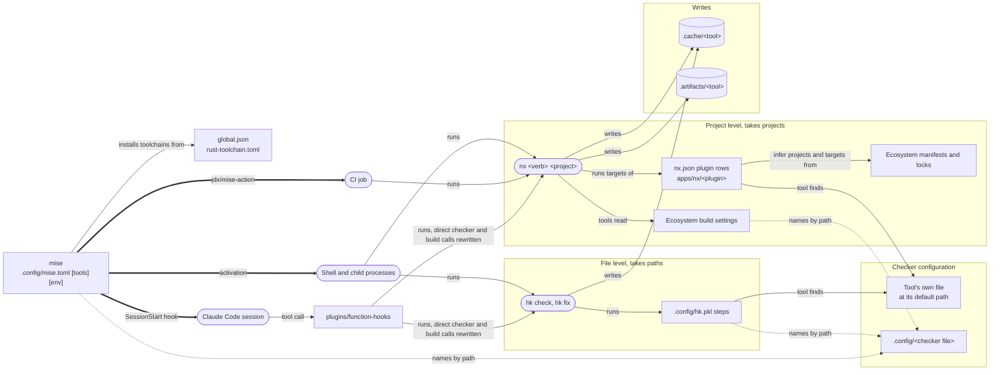

# [RASM]

Rasm is a polyglot monorepo with macOS-first development and portable code and tooling for Linux and Windows.

## [01]-[LAYOUT]

```text
Rasm/
├── apps/                     # Products by host or interface
├── libs/                     # Packages by language
├── tests/                    # Suites per language, at the path of the project they test
├── tools/                    # Checks and grammars other checkers lack, by the tool that runs them
├── assets/                   # Reusable assets no one app or plugin owns, each app or plugin keeps its own assets in its folder
├── infra/                    # Pulumi programs for the repository, its machines, and app hosting
├── plugins/                  # Agent harness marketplace
├── docs/
├── nx.json                   # One row per Nx plugin and the release policy
├── package.json              # Workspace root package
├── pnpm-workspace.yaml       # TypeScript workspace globs and dependency catalog
├── tsconfig.base.json        # TypeScript options every package compiles and emits with
├── tsconfig.web.json         # TypeScript options for bundled browser code
├── tsconfig.worker.json      # TypeScript options for test suites running in workerd
├── biome.json                # TypeScript and JSON formatting and lint
├── pyproject.toml            # Python workspace root, catalog groups, and checker settings
├── Workspace.slnx            # .NET solution listing every project
├── global.json               # .NET SDK and test runner
├── Directory.Packages.props  # .NET central package versions
├── Directory.Build.props     # .NET build defaults and artifacts output
├── Directory.Build.targets   # .NET items and Rhino SDK references
├── NuGet.config              # NuGet sources
├── Package.swift             # Swift modules, executables, and remote package catalog
├── Xcode.xcconfig            # Build settings every Xcode project inherits
├── Cargo.toml                # Rust workspace and dependency catalog
├── rust-toolchain.toml       # Rust toolchain channel and components
├── CMakeLists.txt            # C++ root project finding each package by its CMakeLists.txt
├── CMakePresets.json         # C++ configure, build, test, package, and workflow presets
├── vcpkg.json                # C++ library versions, registry baseline, and overlay triplets
├── .clang-format             # C++ and Objective-C++ formatting
├── .clang-tidy               # C++ checks and house rules, each finding an error
├── .clangd                   # C++ language server compilation database folder
├── sgconfig.yml              # ast-grep rule directories and language parsing
├── .editorconfig             # Editor, formatting, and analyzer settings by file path
├── .gitattributes            # Line endings, diff drivers, and LFS filters per extension
├── .gitignore                # Generated, secret, and machine-local paths
├── .github/                  # Workflows, composite actions, issue forms, and jactionlint settings
├── .cargo/                   # Cargo build settings and compiler source link
├── .config/                  # Files tools find in .config/ or read through a path setting
├── .claude/                  # Claude Code knowledge and settings
├── .mcp.json                 # Claude Code MCP servers
├── .codex/                   # Codex knowledge and settings
├── .agents/                  # Skills Codex and Antigravity read, Antigravity hooks
├── .vscode/                  # VS Code settings and recommended extensions
├── CLAUDE.md                 # Agent standards, AGENTS.md is its symlink
└── README.md
```

## [02]-[FLOW]

Thick arrows supply tools and variables, solid arrows run, read, or write, and dotted arrows name a file by path:



## [03]-[PRINCIPLES]

- Each fact sits once in the file its tool reads, and every other use derives it
- Nx plugins infer every project, target, and dependency from manifests and tool output, with no `project.json` or hand-written `namedInputs`
- `nx.json` `targetDefaults` holds one row, keyed `@nx/js:release-publish`: Nx core infers that publish target for a public package after every plugin, and the row runs it as `pnpm publish --recursive` after its build targets
- `@rasm/nx-cargo` infers the `default` named input of a crate (its files, the workspace lock, manifest, toolchain, and Cargo variables), so every target of the crate reads them
- Cargo, uv, SwiftPM, and xcodebuild targets read the committed lock (`--locked`, `--force-resolved-versions`, `-onlyUsePackageVersionsFromResolvedFile`), cargo `build` and `fix` alone bring `Cargo.lock` in line with its manifests
- `@rasm/nx-apple` reads Xcode build settings with `-IDEPackageEnablePrebuilts=NO`, so graph creation fetches no prebuilt `swift-syntax`
- Manifest `nx` tables state only a fact no manifest row or tool reports (a service a client calls, a file a build reads unimported, tag `os:all`)
- Plugin rows of `nx.json` share the options under `pluginsConfig` `@rasm/nx-distribution`, and a row's own options win
- Plugin rows merge in order and a later row names a shared root, so `@rasm/nx-distribution` comes first and a host manifest names only a folder no ecosystem manifest names
- Verbs name one operation in every ecosystem, and a project answers a verb only where one of its tools performs that operation
- Verbs aggregate `<verb>--<tool>` targets and read their inputs, and one run's arguments go to the tool-named target (`nx run <project>:build--dotnet -- -bl`)
- File-level formatting and linting belong to hk, project-level checks to the Nx plugins, and neither calls the other
- Commits run no pre-commit hook: hk checks a commit's message alone, and file checks run when a shell or agent calls hk
- Checkers report every finding as an error through their own configuration
- Checker configuration named by path sits in `.config/`, since tools run through hk and Nx alone, never directly
- Libraries take paths, names, and policies from their caller and hold no repository convention
- Caches sit under `.cache/<tool>` and generated output under `.artifacts/<tool>`, `dist`, `.cloudflare/output`, and editor-shared folders stay where their tool puts them
- Published apps read their identity from the host API (`Bundle.main`, `process.execPath`) and keep settings in their own preferences
- Apps and tools made here default cache, log, and runtime folders to per-user locations, one documented setting moves each, each bounds its logs
- `.config/mise.toml` `[env]` rows move the folders: caches to `.cache/<tool>`, logs under `.artifacts/logs` in a file or folder per tool
- Tool behavior comes from its source and docs at the installed version, a plugin never restates what a tool, host, package, or Nx already does
- Tools with their own incremental state keep it, Nx caches results around it and restores an intermediate folder only with the outputs built from it
- Task inputs hold the files a task's tool reads: plugin and executor source, `.config/mise.lock`, tool `--version` output, and credentials are no input
- Cached targets with output that differs by platform hash one platform input, since one remote cache serves every runner
- Host SDKs and tools come from packages and mise rows, and building, checking, and packaging a host project needs no host installed
- Hosts run wherever their vendor releases and licenses them for a machine, CI runners included, as Blender does through its `bpy` wheel
- Plugins present a target that runs a host or needs a platform only on a machine holding it, and tag a project a platform limits `os:<platform>`
- Tests of code calling a host run where the host runs, and logic needing no host sits in projects tested on every platform
- `@rasm/nx-cmake` configures the build folder each configure preset states and infers projects, targets, and edges from its file API reply
- CMake workflow presets name the configure, build, and test presets of one Nx configuration, and a build step after the test step runs last
- `check` builds the workflow whose configure preset names a clang-tidy launcher, `pack` the first package preset a workflow configures
- C++ compilers, clang tools, and libc++ with its `std` module come from the mise LLVM row, CMake, Ninja, gersemi, vcpkg, and pkgconf from theirs
- C++ libraries come from `vcpkg.json` through an overlay triplet, which builds each library with the toolchain file of the preset
- C++ executables link the LLVM release libc++ statically, its symbols hidden on macOS, where a second libc++ beside the system one corrupts streams
- C++ warnings, hardening, sanitizer, and coverage flags sit in the root `CMakeLists.txt`, presets state a build type, a build folder, and switches
- C++ packages export a named module where `CMAKE_CXX_SCAN_FOR_MODULES` is on, and declare the part a host toolchain reads in `FILE_SET HEADERS`
- Unreal targets exist where the engine a `.uproject` names resolves, a plug-in builds once per engine the projects loading it name
- Unreal plug-ins build through `RunUAT BuildPlugin -StrictIncludes`, and a project builds its editor target through UnrealBuildTool
- Unreal plug-ins test by the automation tests under their own name, each test state read from the report the editor exports
- Unreal plug-ins map a folder to the Nx target installing a C++ package there in `.uplugin` table `nx.packages`, and their build runs it first
- Preset `unreal` builds such a package with the compiler and flags of the plug-in's engine, into a folder named for the engine platform (`Mac`, `Linux`)
- Rhino code runs no Rhino-hosted tests, as Rhino.Inside has no released Mac host and `RHINO_TOKEN` licenses Rhino only on Windows Server and Linux
- Suites reading the project graph take tag `os:all` and hash one platform input
- Suites reading the live tree compare what running tasks leave alone: a task reading its dependencies' outputs hashes files those tasks write
- Workflow checkouts fetch full history (`fetch-depth: 0`, no `filter`): `nx release` compares the files of each commit, which a partial clone fetches one commit at a time
- CI checkouts keep ignored files (`clean: false`) and remove untracked ones, so caches and packages stay in a work folder a runner keeps
- Host and container jobs run on separate runner instances, each with its own work folder: cached absolute paths name one mount path
- CI job `unreal` keeps its tools and package store under `.cache` of its checkout, which its container mounts
- CI jobs run as many tasks at once as their machine has cores (`NX_PARALLEL`), and never stop at a first failed task
- CI job `affected` lists the affected `os:linux` projects, and job `unreal` runs where it lists one
- Listings select by project, never by target: an Unreal project holds no target on a runner outside its engine image
- CI job `macos` starts on every run and its own `nx affected` selects what runs: no Linux graph holds an Apple project to list
- CI job `linux` runs the affected targets of every project without tag `os:darwin`, job `macos` the `os:darwin` and `os:all` projects
- CI jobs `affected` and `linux` run on runner instance `host` of role `Runner` and job `unreal` on instance `container`, at once
- Role `Runner` keeps tools, ignored files, and each Unreal image between runs, and workflow `Maintenance` clears ignored files weekly
- CI job `unreal` runs the affected `os:linux` projects in Epic's `dev-slim` image of each `EngineAssociation` a `.uproject` names
- Workflow `Deploy` runs `nx deploy @rasm/infra` once the CI run of the newest push to `main` finishes, passed or failed, and when Doppler config `deploy` changes
- Unchanged stack inputs apply nothing, and a machine runs the containers and services field `roles` of its `hosts` row states
- Machine names state no role, provider, or location: roles sit in host row `roles`, DNS aliases, and tailnet tags
- Machines with role `Watch` check their own services and the public services and checker of every other machine, and alert through role `Notify`
- Plugins tag a project they give release configuration `release`, the one selector of `nx.json` `release.projects`
- `package.json` projects stating a `version` are release projects with `pack--pnpm` and `attach--gh`, and `private` stops the registry upload alone
- Release projects are versioned, packed, and attached, and the switch their registry reads alone gives one a publish target
- Registry switches are `private` in `package.json`, `publish` in `Cargo.toml`, classifier `Private :: Do Not Upload`, and `defaultPushSource` of `NuGet.config`
- Crates stating no `version` are no release project, as Cargo publishes none
- Publish targets upload where the credential variable their tool reads is set, and name the variable and succeed where it is not
- Pack targets build their release form themselves, `pack--dotnet` excepted
- .NET targets of a project run in the one `Configuration` MSBuild evaluates for it, and test and pack read what `build--dotnet` wrote (`--no-build`)
- `Directory.Build.props` states `Configuration` and `Configurations` as `Release`, and a project declaring more gets an Nx configuration for each
- `@rasm/nx-dotnet` runs its analyzer through `dotnet run`, which rebuilds it after a source edit, and from the build its package holds once installed
- NuGet supplies no fixed entry time, so `Directory.Build.props` states `DeterministicTimestamp` and two packs of one commit are byte-equal

## [04]-[TASKS]

`nx <verb> <project>` runs one project, `nx affected -t <verb>` runs changed work, and `--files=<path>` limits it to one change's reach:
- `codegen` writes source code a project's tools derive from its schemas and configuration
- `build` compiles or packages a project into its declared outputs
- `pack` writes the files a release holds where they differ from the build (`.tgz`, `.nupkg`, CPack archive, app `.zip` or `.dmg`)
- `attach` uploads the files a project's packaging targets wrote to the GitHub release of its version
- `check` reports findings of checkers reading the project model and changes no source file
- `fix` applies fixes from checkers reading the project model
- `test` runs a project's test runners
- `serve` runs a project's development servers until the run ends, where a Vite config holds `nxReadySignal()` of `@nx/vite` or states `server`, and starts the Compose services whose Dockerfile it holds, which stay up
- `preview` builds a project, then serves its build output as `serve` does
- `install` puts a local build into its host or starts local services
- `deploy` applies a project's infrastructure stacks, and `-c release` those of a released version
- `nx run <project>:deploy--pulumi --stack=<name>` applies one stack, and `--operation=preview` prints the changes an apply makes
- `upgrade` moves an ecosystem root's dependency requirements and locks to newer releases through its own tool
- `clean` removes the outputs a project's targets declare and runs its tool's clean

Other tasks run through their own commands:
- `nx build @rasm/nx-apple-darwin-arm64` builds the core `@rasm/nx-apple` reads Xcode projects through, on a Mac after a clone
- `hk check <paths>` and `hk fix <paths>` run every file-level checker and writer over the named paths
- Playwright `webServer` rows with `reuseExistingServer` and command `nx run <project>:<target>` start that target and wait for its address
- Workflow `release.yml` runs `nx release --skip-publish` (one version, tag, and GitHub release), `nx run-many -t attach -c release`, then `nx release publish`
- Job `unreal` of `release.yml` then attaches the `os:linux` projects from the same image at the released commit
- Dispatch inputs of `release.yml` are `specifier` (empty reads conventional commits), `first-release`, `dry-run`, on by default, and `publish`
- Attach and publish targets depend on the targets that package their files (`pack--dotnet` for NuGet) and take them as the `dependentTasksOutputFiles` input they state
- `pnpm publish --recursive` states no such input, takes no file, and depends on the build targets of its package
- `doppler run --config release --command 'nx pack <app>'` packages a Mac app as workflow `release.yml` does
- `mise bootstrap` registers the pitchfork supervisor as a login agent, on a Mac after a clone
- `nx install @rasm/infra` runs the proxy, sign-in, and object storage containers of role `Apps` on the local Docker engine, under `rasm.localhost`
- `mise daemons stop docker` stops the container engine until a session enters, `mise daemons start docker` starts it and waits until Docker answers
- `nx deploy @rasm/infra` applies the repository and machine stacks, as workflow `Deploy` does
- `nx migrate latest`, then `nx migrate --run-migrations`, applies a new Nx release's migrations
- `nx sync` writes each executor's `schema.json` and `executors.json` description from its declared options schema, `nx sync:check` fails on a stale one
- `mise deps` builds Python distributions against Pixi libraries when `pixi.lock`, `pyproject.toml`, or `uv.lock` changed, through `pixi run --locked uv sync`
- `pixi run --locked python` supplies the library search path for `magic` and `weasyprint`

## [05]-[DELIVERY]

Packaging turns a build into the files its host, registry, or store takes, and install and publish each use those files:
- Hosts and ecosystems decide package format (`.yak`, `.nupkg`, wheel, `.dmg`, CPack `.tar.xz`)
- C++ packages release as a CPack archive of their install tree with a CPS file and an SPDX SBOM, CPack naming it from project, version, and system
- Unreal plug-ins release per engine as the BuildPlugin package and a source archive with its installed packages and that `EngineVersion`
- Fab takes no upload from a tool: its publishing portal takes the source archive of a GitHub release by link, after the store checks pass
- Plugin technology decides a host's package and install form (UXP `.ccx`, CEP `.zxp`), never where it publishes
- Installs serve development alone, replacing a previous build where its host loads it and skipping packaging where the host allows
- Releases give every project one version and tag through `nx release`, and the GitHub release holds the packaged files each `attach` target uploads
- Publishing delivers through each destination's own command (`pnpm publish`, `cargo publish`, `dotnet nuget push`, `uv publish`, `yak push`)
- `dotnet nuget push`, `uv publish`, `yak push`, and the Blender extensions upload deliver the files `pack` or `build` wrote
- `pnpm publish --recursive` and `cargo publish` take no packed file: each packs its package again, pnpm the folder its build targets wrote in the same run
- `pnpm publish --recursive` skips a version its registry holds, as `dotnet nuget push --skip-duplicate` and the host store checks do, and `cargo publish` fails on one
- Release assets hold native files unwrapped, a folder product (Unreal plugin, `.app`) goes in a `.zip` or `.dmg`, and a `.dmg` gets a Sparkle feed in R2
- Every ecosystem and host is delivered end to end (install, package, release, publish), and none stays partly built

## [06]-[OWNERS]

| [INDEX] | [CONCERN]                      | [OWNER]                                                                                                |
| :-----: | :----------------------------- | :----------------------------------------------------------------------------------------------------- |
|  [01]   | Tool binary                    | `.config/mise.toml` `[tools]`, exact versions in `.config/mise.lock`                                   |
|  [02]   | Process variable               | `.config/mise.toml` `[env]`, platform-only values in `.config/mise.<os>.toml`                          |
|  [03]   | Toolchain version              | `global.json` .NET, `rust-toolchain.toml` Rust, uv root `requires-python` Python, `xcode-select` Swift |
|  [04]   | Package version                | `pnpm-workspace.yaml` catalog, `pyproject.toml` `[project]` or group, `Directory.Packages.props` row   |
|  [05]   | .NET tool package              | `.config/mise.toml` `[tools]` `dotnet:<id>` row at `latest`, its command called by name                |
|  [06]   | Task graph                     | `nx.json` plugin rows, inference in `apps/nx/<plugin>`                                                 |
|  [07]   | Checker configuration          | Tool's own file, in `.config/` where a path names it, `pyproject.toml` `[tool.*]` for Python tools     |
|  [08]   | File-level check               | `.config/hk.pkl` step                                                                                  |
|  [09]   | Secret                         | Doppler `rasm` project and 1Password, read through the `secrets` skill                                 |
|  [10]   | Resource or repository setting | Typed row of an `infra/` program, applied by workflow `Deploy`                                         |
|  [11]   | Service definition             | Role of a `hosts` row in `infra/platform-stack.ts`, rows of an app's `hosting.config.ts`               |
|  [12]   | Xcode build setting            | `Xcode.xcconfig`, per-product rows in the `.xcodeproj` target                                          |
|  [13]   | Swift package version          | Root `Package.swift` `dependencies` row, `.xcodeproj` `remote` row for a package only an app imports   |
|  [14]   | Rust package version           | `Cargo.toml` `[workspace.dependencies]` row                                                            |
|  [15]   | Agent harness plugin           | `plugins/<name>`                                                                                       |
|  [16]   | Native libraries for sdists    | Pixi `default` environment in `pyproject.toml`, exact builds in `pixi.lock`                            |
|  [17]   | Container runtime              | Mise clients, Colima on macOS                                                                          |
|  [18]   | Agent browser options          | `.config/mise.toml` `[env]` `PLAYWRIGHT_MCP_*` rows, `PLAYWRIGHT_CLI_SESSION` per agent session        |
|  [19]   | Reusable asset                 | `assets/<kind>/<name>/` in `bsamiee/Rasm-Assets`, with native relative dependencies                    |
|  [20]   | Local daemon                   | `[daemons]` row in `.config/mise.<os>.toml`, started with the first shell or agent session             |
|  [21]   | Host application in CI         | Host vendor's setup action in the job needing it, its version read from the project manifest           |
|  [22]   | Mac app release form           | Doppler `rasm/release` `ASC_API_*` rows, set notarize a `.dmg` for Sparkle, absent release a `.zip`    |
|  [23]   | Registry token                 | Doppler `rasm/release` row named as the variable its tool reads (`NODE_AUTH_TOKEN`, `YAK_TOKEN`)       |
|  [24]   | C++ toolchain and packages     | `github:llvm/llvm-project` row of `.config/mise.toml`, `vcpkg.json` rows and `builtin-baseline`        |
|  [25]   | Unreal Engine                  | `EngineAssociation` of a `.uproject`, found in Epic install lists                                      |
|  [26]   | Deploy credential              | Doppler `rasm/deploy` rows named as the variable each provider reads, `DOPPLER_IAC_TOKEN` as its token |
|  [27]   | Machine                        | Row of table `hosts` in `infra/platform-stack.ts`, reached by its tailnet name over Tailscale SSH      |
|  [28]   | Public service name            | `<service>.<zone>` of the machine running it, a CNAME to that machine                                  |

- Tool rows stay at `latest` where their backend lists releases, a `version_regex` over release tags excludes a development build `latest` resolves

## [07]-[STRUCTURE]

- Projects hold no `src/` directory
- Libraries sit at `libs/<language>/<category>/<package>/`, categories name the concern spanning their packages and siblings that field anticipates
- New categories start from the package being made, its sibling packages outside it, and the higher-order concern they share
- Packages are named by the term practitioners use for that concern
- Projects a host loads target the runtime and libraries their host bundles, and build output holds none of them
- Each uv root resolves one Python range: projects on a host's Python get their own root, and a package shared across roots declares the lower bound
- C++ packages sit at `libs/cpp/<category>/<package>/` with their own `project()` call, tests at `libs/cpp/<category>/tests/<package>/`
- Unreal projects and plug-ins sit under `apps/unreal/`, a plug-in beside the project enabling it, whose `Plugins` folder takes its installed package
- Swift modules are root `Package.swift` targets, each in its own folder under `libs/swift/<category>/`, executables under `apps/macos/`
- SQL schemas reconcile the live database to owning types, with no migration, history table, or versioned file or folder
- Reconciles drop or retype only what owning types declare retired or retyped
