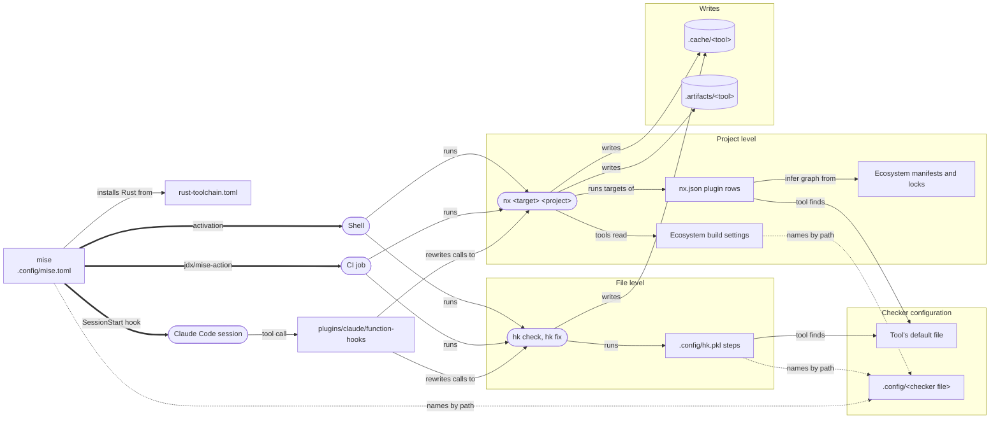

# [RASM]

Rasm is a polyglot monorepo with macOS-first development and portable code and tooling for Linux and Windows.

## [01]-[LAYOUT]

Folders name categories down to a project, the first folder holding a manifest, and folders inside a project group its own concepts:

```text
Rasm/
├── products/
│   ├── apps/                 # Projects based on other vendors' applications
│   ├── developer/
│   ├── ai/
│   ├── macos/
│   ├── cli/
│   └── web/
├── libs/                     # Packages by language, then category
│   ├── cpp/
│   ├── dotnet/
│   ├── python/
│   ├── rust/
│   ├── swift/
│   └── typescript/
├── tests/                    # Suites by the category of what they test
│   ├── products/
│   ├── libs/
│   ├── tools/
│   ├── e2e/                  # Suites against a served or installed product
│   └── support/              # Test harnesses by language
├── tools/                    # Checks other checkers lack
│   ├── ast-grep/             # Rules and outline catalogs per language
│   ├── conformance/          # Nx project graph and workspace files
│   ├── dylint/               # Rust
│   └── refurb/               # Python
├── assets/                   # Repo submodule durable assets no product owns
├── infra/                    # Pulumi programs for the repository, machines, and hosting
├── plugins/                  # Agent harness plugins, shared or per host
├── docs/                     # Repo guides and standards by topic and language
├── nx.json                   # Nx plugins, release, and conformance
├── package.json              # TypeScript
├── pnpm-workspace.yaml       # TypeScript workspace and central package catalog
├── tsconfig.*                # TypeScript
├── vitest.config.ts          # TypeScript
├── .oxlintrc.json            # TypeScript and JavaScript
├── .oxfmtrc.json             # TypeScript, JavaScript, and data files
├── pyproject.toml            # Python workspace and central package catalog
├── Workspace.slnx            # .NET workspace
├── global.json               # .NET
├── Directory.Packages.props  # .NET central package catalog
├── Directory.Build.props     # .NET
├── Directory.Build.targets   # .NET
├── NuGet.config              # .NET
├── Package.swift             # Swift workspace and central package catalog
├── Xcode.xcconfig            # Swift
├── Rasm.xcworkspace/         # Swift, one Xcode build folder and package clone for every app and root package
├── Cargo.toml                # Rust workspace and central package catalog
├── rust-toolchain.toml       # Rust
├── .cargo/                   # Rust
├── CMakeLists.txt            # C++ workspace
├── CMakePresets.json         # C++
├── vcpkg.json                # C++ central package catalog
├── sgconfig.yml              # ast-grep
├── .editorconfig
├── .github/
├── .config/                  # Tool configuration
├── .claude/
├── .claude-plugin/           # Marketplace for Claude Code and Codex
├── .codex/
├── .vscode/
├── CLAUDE.md                 # Agent standards, linked as AGENTS.md
├── LICENSE
└── README.md
```

## [02]-[PRINCIPLES]

- Each fact sits once in the file its tool reads, and every other use derives it
- Tool behavior comes from its source and docs at the installed version, and configuration sets only what departs from it
- Tools read configuration from `.config/` where a setting names its path, else from their fixed path, and checkers report every finding as an error
- Each ecosystem pins every version, root tooling included, in its root catalog and lock, and targets build from the committed lock
- State sits in the folder its lifetime matches, inside the folder a cache saves or outside the folder a reinstall replaces
- Changes start from reading the file and log line their claim cites, as docs and reviews state facts those files contradict
- `hk check <paths>` and `hk fix <paths>` run `.config/hk.pkl` steps over named paths and its `commit-msg` hook over commit messages
- Checkers reading only the files or project folder hk names run as hk steps, and checkers reading an environment or the repository as Nx targets
- Checkers reading given files alone run in hk, tools reading an environment or whole repository as cached Nx targets, and neither calls the other

## [03]-[FLOW]

Thick arrows supply tools and variables, solid arrows run, read, or write, and dotted arrows name a file by path:



## [04]-[MISE]

mise installs every tool, `[env]` holds process variables, and `[bootstrap]` holds what a machine's OS keeps across boots:
- `mise bootstrap` configures a machine for the workspace after a clone
- `mise install` installs every tool and project dependency and sets the rustup default to the pinned toolchain
- `mise install` runs `cargo clean` in a checkout whose build folder another compiler wrote, read from the `.rustc_info.json` Cargo keeps there
- New compilers rebuild every crate beside the old one's artifacts Cargo keeps, and a new Rust toolchain prunes the old one with its compiler source
- `.config/mise.toml` `[tools]` rows stay at `latest` where a backend lists releases, and a `version_regex` excludes development builds
- Platform rows sit in the `.config/mise.<os>.toml` mise loads, as only a file limits a row to one OS
- `.config/mise/locks/` holds the dependency lock mise writes for each npm and PyPI tool row, and a locked install fails without it
- Checkers a uv or pnpm catalog can hold sit there, never in an npm or PyPI tool row
- `hk check` runs `mise lock --check` under no profile and under `ci`, as a row its lock lacks fails every locked install
- Doppler project `rasm` and 1Password hold every secret, a registry token as a `rasm/release` row named as the variable its publish target reads

## [05]-[WORKSPACES]

Projects inherit versions and settings from their ecosystem root:

| [INDEX] | [ECOSYSTEM] | [VERSIONS]                                                 | [SETTINGS]                                                |
| :-----: | :---------- | :--------------------------------------------------------- | :-------------------------------------------------------- |
|  [01]   | TypeScript  | `pnpm-workspace.yaml` `catalog`, manifests name `catalog:` | `tsconfig.base.json`, project `types`, `lib`, and `jsx`   |
|  [02]   | Python      | `requires-python`, root group catalog, member lower bounds | Root `[tool.*]`, `[tool.uv]` and `[tool.ty]` per uv root  |
|  [03]   | .NET        | `dotnet` row of mise, root `Directory.*.props`             | Root and folder `Directory.Build.props`, folder sets kind |
|  [04]   | Rust        | `rust-toolchain.toml`, `[workspace.dependencies]`          | `Cargo.toml` `[workspace.*]`, `.cargo/config.toml`        |
|  [05]   | Swift       | `xcode-select`, root `Package.swift` `dependencies`        | `Package.swift` `swiftSettings`                           |
|  [06]   | C++         | LLVM row of mise, `vcpkg.json` `builtin-baseline`          | `CMakeLists.txt` flags, `CMakePresets.json` presets       |

Roots split, nest, or hold more where a host or tool decides:
- Each uv root resolves one Python range, host Pythons take a root pinned to what each host bundles, and shared members require the lowest version
- `[tool.uv]` applies from the root being locked alone, and nested uv roots take a `[deps.<root>]` mise row
- Pixi supplies native libraries for sdists, and `pixi run --locked python` runs Python with them on the library search path
- Host SDKs come from packages, every OS builds, checks, and packs host projects, and only running a host needs it installed, Unreal Engine aside
- Host projects target their host's runtime and carry every dependency except SDK assemblies the host supplies
- Folder `Directory.Build.props` files name a host, and conditional `Update` rows of `Directory.Packages.props` read its runtime line
- .NET runs but Rhino suites build Release unless they name `debug`, which reaches references and Yak packages, and assemblies embed their PDB
- Projects reach ImageSharp through `Rasm.Imaging`, as ImageSharp fails unsigned Release builds and `.config/licenses/sixlabors.lic` signs it alone
- Swift modules, app code included, are root `Package.swift` targets, and Xcode app targets hold bundle, icon, and signing over their app module
- Xcode app projects build through root `Rasm.xcworkspace`, as projects built apart each clone every package and compile it again
- Root `Package.swift` builds and tests in that workspace through shared scheme `Rasm-Package`, which lists every module, in place of SwiftPM
- Scheme `Rasm-Package` tests through default plan `.config/Rasm-Package.xctestplan` and measures through `.config/Performance.xctestplan`, each listing its test targets by name
- Nx project `Rasm-Package` at `Rasm.xcworkspace` holds the root package's Swift and Xcode targets, and root project `rasm` holds none
- Workspace `Package.resolved` links to the root one, which `swift package update` moves and `xcodebuild` reads and writes through the link
- User default `IDEPackageOnlyUseVersionsFromResolvedFile` of mise `[bootstrap]` holds Xcode windows to resolved versions, as builds are
- `.config/xcode.xcconfig` turns on the Xcode compilation cache, `Xcode.xcconfig` includes it, and its hits need an unchanged build folder path
- Mise variable `XCODE_XCCONFIG_FILE` applies it to every target `xcodebuild` builds, as a package scheme otherwise compiles every module again
- User default `CompilationCachingDiskSizeLimit` of mise `[bootstrap]` caps that cache, as Xcode otherwise lets it reach half the free disk
- C++ packages each declare their own `project()`, and toolchain, presets, CI, and release stay whole before any package exists
- Unreal plug-ins sit beside the project enabling them, and name each C++ package they build with their engine's compiler in `.uplugin` `nx.packages`
- SQL schemas reconcile the live database to owning types with no migration files, and drop or retype only what an owning type retires

## [06]-[NX]

Nx runs project-level work over a graph its plugins infer:
- Plugins use what Nx and its official plugins provide, and behavior an `nx.json` field or plugin option can state stays out of plugin code
- Plugins infer every project, target, and dependency from manifests and tool output, and manifest `nx` tables add only facts no tool reports
- Plugin globs match only files marking a project at their path, as a changed match reconfigures its project and a deleted one selects every task
- Inferred targets hold one configuration on every machine of a platform, as Nx hashes every target of a project into each of its tasks
- Hash inputs name a tool by identity (compiler version, platform, installer URL) and no machine path, as host state differs between machines
- Tool tables stay in the manifest their tool reads in place of a file per table, as Nx hashes input files whole
- `mise install` builds .NET and Swift analyzers before graphs, and a missing one leaves its projects out with a warning naming its build
- Stale analyzers fail the graph, and a missing Swift analyzer leaves out Xcode targets alone
- `nx affected -t <target>` runs only the tasks whose inputs a change reaches, aggregate targets included
- Nx hashes each input file whole and filters JSON fields alone, so an edit to one tool's table of a manifest reruns every task hashing that manifest
- Tasks hash their executor's workspace package and that package's direct workspace dependencies
- Tools keep their own incremental state, and Nx caches results around it in one remote cache that pull request runs read alone
- `nx sync` writes executor schemas and tsconfig `references`, and non-terminal runs outside CI stop on stale ones until it runs, never `--skip-sync`
- `nx conformance:check` runs `nx.json` conformance rules over the graph and every target
- Use `docs/Nx.md` for Nx behavior plugins and `nx.json` rows rely on

`nx <target> <project>` runs one project, each target one operation in every ecosystem:
- `codegen` writes source a project's tools derive from its schemas and configuration
- `build` compiles or packages a project into its declared outputs
- `check` reports findings and `fix` applies fixes of checkers reading the project model
- `test` runs a project's test runners
- `serve` runs a project's development servers until the run ends
- `preview` builds a project, then serves its build output as `serve` does
- `upgrade` moves an ecosystem root's dependency requirements and locks to newer releases through its own tool
- `clean` removes the outputs a project's targets declare through its tool's clean, and configuration `cache` empties the caches its tools keep

Workspace commands run from the root:
- `nx upgrade` moves every project to newer releases, then every mise tool row and its lock
- `nx migrate <version>`, `nx migrate --run-migrations`, then `pnpm dedupe` apply a new Nx release
- `nx clean` removes every output in and outside the repository, and `nx clean -c cache` empties every cache

## [07]-[TESTING]

Suites sit in `tests/` except where their tool fixes the place:
- Suites stay inside a nested tool root that stops discovery at its root (SwiftPM analyzer) or a plugin folder published whole
- Projects needing no host run on every platform, and tags `os:<platform>` and `host:<host>` mark projects a toolchain, framework, or host limits
- C++ projects take one Nx configuration per CMake workflow preset (`nx test <project> -c asan`), and the first preset is the default
- Swift suites reading another process fail where `xctest` lacks its grant, which CI writes and a Mac takes once per Xcode build

Rhino suites boot Rhino once per test process, one run per machine, as concurrent processes opening views on one Cloud Zoo license each raise a prompt:
- Local runs on a machine with Rhino open views, or none under `nx test <project> -c headless`, in a scratch profile seeded with license files
- CI tests Rhino suites headless on Windows runners through Rhino.Inside, over the newest release of their pinned major

## [08]-[DELIVERY]

Products deliver through the same targets in every ecosystem, development builds to a local host and releases to GitHub and each product's channel:
- Targets write every deliverable from the built product, store screenshots and promo tiles included, with no hand-made file
- `install` puts a development build where its host loads it, replacing the last and skipping packaging where allowed, or starts local services
- `pack` writes release files that differ from build output, in its host or ecosystem's form, a folder product in a `.zip` or `.dmg`
- `doppler run --config release --command 'nx pack <app>'` packs a Mac app with release signing, notarized as a `.dmg` holding the stapled ticket where `ASC_API_*` rows are set
- Mac apps whose Info.plist states `SUFeedURL` take a Sparkle feed of their `.dmg` from `nx release publish`, and other Mac apps release through `attach` alone
- Commit scopes name one project as `nx show projects` prints it, or none, as `nx release` refuses a scope matching more than one `release` project
- `nx release --skip-publish` versions each `release` project alone from commits since its `<project>@<version>` tag, tags it, and patches dependents
- Unscoped breaking commits touching a file every project hashes (`nx.json`, `pnpm-lock.yaml`) bump every `release` project
- Conventional commits since a project's last tag write its GitHub release notes without authors, and no changelog file exists
- New `release` projects take an annotated `<project>@<version>` tag by hand at their manifest version, in place of `--first-release`
- `nx release <version> --projects=<projects> --skip-publish` moves projects to an exact version alone, as a prerelease line takes its stable release
- `nx run-many -t attach -c release` uploads released files to each tag's GitHub release, and stores with no upload API take files by hand
- `attach` creates a tag's GitHub release where none exists, as `nx release` makes none for hand-made tags or dependents outside `--projects`
- `nx release publish` sends the same files to each registry or store its ecosystem's publish setting allows, skipping until a credential is set
- Store items take their first upload by hand at the store dashboard, as store APIs publish only to listed items
- `deploy` applies a project's Pulumi stacks after its dependencies', `-c release` a released version's, `deploy--pulumi --stack=<name>` one stack
- `dry-run` previews what `deploy` applies over build output on disk and runs no other task, `dry-run--pulumi --stack=<name>` one stack

## [09]-[MACHINES]

`infra/` Pulumi programs declare what runs on each machine and how it is reached:
- Machines take a `hosts` row in `infra/platform-stack.ts` and a `[bootstrap.remote.hosts]` row, and accounts and tailnet addresses stay in services
- Roles in a `hosts` row decide a machine's services, and a role's OS state sits in the mise environment its bootstrap row loads
- Stacks declare every container image a machine or CI job runs and build those no registry publishes, and `.github/` holds no Dockerfile or image build
- App `hosting.config.ts` targets name Cloudflare or a machine with role `Apps`, and `nx install @rasm/infra` runs role `Apps` under `rasm.localhost`
- Container engines run under systemd on machines and, on the owner's Mac, in a Colima VM `DOCKER_HOST` names
- Project `colima` exists where `COLIMA_HOME` names a workspace folder, as on macOS, and its `install--colima` starts the VM and leaves it up
- Packages requiring an engine client take tag `host:docker`, and their `test--*` and `install--*` tasks depend on `install--colima` where one exists
- Colima keeps its VM in `.cache/colima`, `clean--colima` prunes images and trims its disk, and `nx clean -c cache` deletes it
