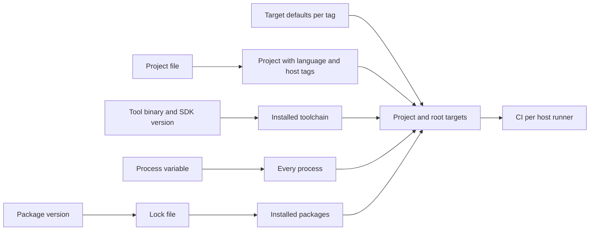

# [RASM]

Rasm is a polyglot monorepo with macOS-first development and portable code and tooling for Linux and Windows.

## [01]-[LAYOUT]

```text
Rasm/
├── apps/
│   ├── blender/
│   ├── creative-cloud/
│   ├── macos/
│   ├── rhino/
│   └── web/
├── libs/
│   ├── dotnet/
│   ├── python/
│   ├── rust/
│   ├── swift/
│   └── typescript/
├── assets/                   # Reusable assets no one app or plugin owns, each app or plugin keeps its own assets in its folder
├── tests/
├── eng/
├── infra/                    # IaC programs for repository and app hosting resources
├── docs/                     # Research sheets, ignored under docs/research
├── tools/
│   ├── ast-grep/             # Per-language support ast-grep lacks for reading repository code and enforcing syntax-level standards
│   ├── bridge/               # rasm-mcp-bridge binary serving a stdio MCP server over Streamable HTTP
│   ├── dylint/               # Rust lints reading types and resolved paths Clippy lacks
│   ├── foundry/              # CLI over the typography library, a declared font set reconciled, built, shaped, and published
│   ├── nx/                   # Nx plugin inferring a project from each project file
│   ├── refurb/               # Python checks reading mypy types Ruff lacks
│   ├── roslyn/               # C# analyzers, code fixes, and BannedSymbols*.txt bans
│   └── watch-apps/           # CLI for agents observing and driving desktop apps in the background
├── plugins/                  # Agent harness marketplace
├── nx.json                   # Task graph
├── package.json              # Workspace root package
├── pnpm-workspace.yaml       # TypeScript workspace globs and dependency catalog
├── tsconfig.base.json        # Compiler options every TypeScript project extends
├── tsconfig.json             # Root TypeScript project over files outside every package
├── tsconfig.web.json         # Browser `lib` every web project extends
├── vitest.config.ts          # Root Vitest run over every project suite
├── biome.json                # TypeScript and JSON formatting and lint
├── pyproject.toml            # Python environment, dependency groups, and checker settings
├── global.json               # .NET SDK versions
├── Workspace.slnx            # .NET solution
├── Directory.Packages.props  # .NET central package versions
├── Directory.Build.props     # .NET build defaults and project classification by tree position
├── Directory.Build.targets   # .NET items, host package references, and build targets
├── Directory.Build.rsp       # MSBuild switches every command-line build under the root reads
├── Directory.Solution.props  # Solution restore settings
├── NuGet.config              # NuGet source and per-source request limit
├── Package.swift             # Swift modules, executables, and remote package catalog
├── Xcode.xcconfig            # Build settings every Xcode project inherits
├── sgconfig.yml              # ast-grep rule directories and language parsing
├── Cargo.toml                # Rust workspace and dependency catalog
├── clippy.toml               # Clippy lint options Cargo.toml lint tables lack
├── rust-toolchain.toml       # Rust toolchain channel and components
├── rustfmt.toml              # Rust format rules
├── .editorconfig             # Editor settings and .NET formatting options
├── .gitattributes            # Line endings, diff drivers, and LFS filters per extension
├── .gitignore                # Generated, secret, and machine-local paths
├── .shellcheckrc             # ShellCheck checks off where an ast-grep rule owns the form
├── .swift-format             # Swift lint and format rules
├── .swiftlint.yml            # Swift lint rules swift-format lacks
├── .cargo/                   # Cargo build settings and compiler source link
├── .config/                  # Files tools find in .config/ or read through a path setting
├── .playwright/              # Playwright CLI workspace and browser options every CLI session reads
├── .github/                  # Continuous integration and repository workflows
├── .claude/                  # Claude Code knowledge and settings
├── .mcp.json                 # Claude Code MCP servers
├── .codex/                   # Codex knowledge and settings
├── .vscode/                  # VS Code settings and recommended extensions
├── CLAUDE.md                 # Agent standards, AGENTS.md is its symlink
└── README.md
```

## [02]-[FLOW]



## [03]-[TASKS]

- `git submodule update --init --checkout assets` fills `assets/` for font builds and publishing
- `mise run update` moves tools, catalogs, locks, and action tags to newest releases, reinstalls `tools/` products, and prunes old tool versions
- `mise run clean` removes build outputs and prunes tool caches
- `pixi run --locked uv sync` builds Python distributions against Pixi libraries
- `pixi run --locked python` supplies the library search path for `magic` and `weasyprint`

- `nx:run-commands` targets use `--args='<shell fragment>'` for literal shell characters; the value replaces configured argument defaults
- `nx run <project>:<target> -- <arguments>` appends to the command, paths in place of a root tool's default file set, switches to `dotnet build`
- `nx run <project>:install` builds or packs a product and installs it into its host
- `nx run <project>:publish` pushes the release tagged at `HEAD` to its host's channel
- `nx run <project>:infra [-- <cloudflare|docker>] [--destroy] [--apply]` prints a Pulumi stack difference and `--apply` applies it

- `rasm` holds the repository stack, a release tag at `HEAD` selects production, a missing stack previews as every resource to create
- `nx run rasm:release` prints each product's next version, notes, and `publish` call, `--apply` on a clean tree releases and publishes them
- `nx run rasm:check` runs every root checker and type checker, `nx run rasm:lint:<tool>` runs one checker
- `nx run rasm:format` runs `nx sync`, `dotnet format` over the solution and file-based apps, then `hk fix`, over the paths after `--` when given
- `hk fix <paths>` runs every writer over named paths, or modified files with no path
- `nx run rasm:rewrite:tree -- --filter='^<id>$' <path>` applies one rule's fix across a path
- `nx run rasm:fonts:publish --destination=<folder> [<name>]` copies built faces into a folder

## [04]-[DELIVERY]

Products reach a person through separate levels:
- Repository tooling serves development alone, installing builds over a host's previous install and running local services from the checkout
- Each product's versioned tag and GitHub release mark one release and hold a packaged product's files as an alternative install path
- Each host's install and update channel receives published products

## [05]-[OWNERS]

| [INDEX] | [CONCERN]                      | [OWNER]                                                                                              |
| :-----: | :----------------------------- | :--------------------------------------------------------------------------------------------------- |
|  [01]   | Tool binary                    | `.config/mise.toml` `[tools]`, exact versions in `.config/mise.lock`                                 |
|  [02]   | Process variable               | `.config/mise.toml` `[env]`, platform-only values in `.config/mise.<os>.toml`                        |
|  [03]   | SDK version                    | `global.json` for .NET, `xcode-select` for Swift, `rust-toolchain.toml` for Rust                     |
|  [04]   | Package version                | `pnpm-workspace.yaml` catalog, `pyproject.toml` `[project]` or group, `Directory.Packages.props` row |
|  [05]   | .NET tool package              | `.config/mise.toml` `[tools]` `dotnet:<id>` row at `latest`, its command called by name              |
|  [06]   | Task graph                     | `nx.json`, inference in `tools/nx`                                                                   |
|  [07]   | Checker configuration          | Tool's own file, `pyproject.toml` `[tool.*]` for every Python tool                                   |
|  [08]   | Secret                         | `.config/mise.toml` `DOPPLER_PROJECT` and `DOPPLER_CONFIG`, named in a target's `doppler run` prefix |
|  [09]   | Resource or repository setting | Typed row of an `infra/` program, `<project>:infra`, `rasm` holding the repository                   |
|  [10]   | Xcode build setting            | `Xcode.xcconfig`, per-product rows in the `.xcodeproj` target                                        |
|  [11]   | Swift package version          | Root `Package.swift` `dependencies` row, `.xcodeproj` `remote` row for a package only an app imports |
|  [12]   | Rust package version           | `Cargo.toml` `[workspace.dependencies]` row                                                          |
|  [13]   | Agent harness plugin           | `plugins/<name>`                                                                                     |
|  [14]   | Persistent local process       | Mise `[daemons]` row, platform-only rows in `.config/mise.<os>.toml`                                 |
|  [15]   | Python runtime                 | Mise defaults to 3.15, Blender declares 3.13 in its project manifests                                |
|  [16]   | Native libraries for sdists    | Pixi `default` environment in `pyproject.toml`, exact builds in `pixi.lock`                          |
|  [17]   | Container runtime              | Mise clients, a `[daemons]` `docker` row per `.config/mise.<os>.toml`, Colima on macOS               |
|  [18]   | Shared Vite configuration      | `@rasm/ui/vite` React Compiler plugin, `@rasm/hosting/vite` `cloudflareWorker`                       |
|  [19]   | Shared Vitest and Storybook    | `@rasm/test-support/vitest` `vitestProject`, `@rasm/test-support/main` and `/preview`                |
|  [20]   | Agent browser options          | `.playwright/cli.config.json`                                                                        |
|  [21]   | GitHub Action version          | Published tag on each `uses:` row under `.github/`                                                   |
|  [22]   | Reusable asset                 | `assets/<kind>/<name>/` in `bsamiee/Rasm-Assets`, with native relative dependencies                  |

- Tool rows stay at `latest`, a `version_regex` over release tags excludes a development build `latest` resolves

## [06]-[STRUCTURE]

- Libraries sit at `libs/<language>/<category>/<package>/`, categories name the concern spanning its package(s) and every sibling that field anticipates
- New categories start from the package being made, its sibling packages outside it, and the higher-order concern they share
- Packages are named by the term its practitioners use for that concern
- Caches sit under root `.cache/` and a project's generated output under `.artifacts/`, each tool moved by one setting every run reads
- Tool logs sit flat in `.artifacts/logs/` as one `<producer>.log`, a tool with one partition per run or session holds a folder there
- Xcode apps holding a UXP script build in a folder reference build that script first
- Task graph tags a project `host:<host>` for each `apps/<host>/` folder name in its path, a Swift module and the root project also for each `Package.swift` platform naming an `apps/` folder
- .NET build takes Rhino hosts from the `rhino/` path folder
- Installed Rhino supplies host assemblies at runtime, build output holds none
- Project files are the language manifests and markers Nx plugins read, never `project.json`
- `Workspace.slnx` lists every project `.csproj`
- Swift modules are root `Package.swift` targets, each in its own folder under `libs/swift/<category>/`, executables under `tools/`
- Projects hold no `src/` directory
- SQL schemas reconcile the live database to owning types, with no migration, history table, or versioned file or folder
- Reconciles drop or retype only what owning types declare retired or retyped
