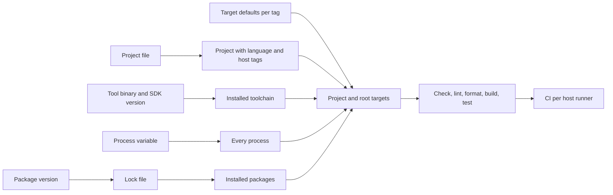

# [RASM]

Rasm is a polyglot monorepo with macOS-first development and portable code and tooling for Linux and Windows.

## [01]-[LAYOUT]

```text
Rasm/
├── apps/
│   ├── blender/
│   ├── creative-cloud/
│   ├── macos/
│   ├── rhino/
│   └── web/
├── libs/
│   ├── dotnet/
│   ├── python/
│   ├── rust/
│   ├── swift/
│   └── typescript/
├── tests/
├── eng/
├── infra/                    # IaC programs for repository and app hosting resources
├── docs/                     # Research sheets, ignored under docs/research
├── tools/
│   ├── ast-grep/             # Grammar extensions, outlines, rules, and utilities per language
│   ├── bridge/               # rasm-mcp-bridge binary serving a stdio MCP server over Streamable HTTP
│   ├── dylint/               # Rust lints reading types and resolved paths Clippy lacks
│   ├── nx/                   # Nx plugin inferring a project from each project file
│   ├── refurb/               # Python checks reading mypy types Ruff lacks
│   ├── roslyn/               # C# analyzers, code fixes, and BannedSymbols*.txt bans
│   └── watch-apps/           # CLI for agents observing and driving desktop apps in the background
├── plugins/                  # Agent harness marketplace
├── mise.toml                 # Tool binaries, process environment, and local daemons
├── global.json               # .NET SDK versions
├── nx.json                   # Task graph
├── package.json              # Catalog rows except tool plugins, root Nx targets
├── pnpm-workspace.yaml       # TypeScript workspace globs and dependency catalog
├── pyproject.toml            # Python wheel project, dependency groups, and tool tables
├── Directory.Packages.props  # .NET central package versions
├── Directory.Build.props     # .NET build defaults and project classification by tree position
├── Directory.Build.targets   # .NET items, host package references, and build targets
├── Directory.Build.rsp       # MSBuild switches every command-line build under the root reads
├── Workspace.slnx            # .NET solution
├── NuGet.config              # NuGet source
├── Package.swift             # Swift modules, executables, and remote package catalog
├── Xcode.xcconfig            # Build settings every Xcode project inherits
├── tsconfig.base.json        # Compiler options every TypeScript project extends
├── tsconfig.json             # Root TypeScript project over files outside every package
├── vitest.config.ts          # Test and coverage options every project config imports
├── vite.shared.ts            # Bundling options every project config imports
├── biome.json                # TypeScript and JSON formatting and lint
├── pmd.xml                   # Java lint rules
├── sgconfig.yml              # ast-grep rule directories and language parsing
├── rust-toolchain.toml       # Rust toolchain channel and components
├── rustfmt.toml              # Rust format rules
├── clippy.toml               # Clippy lint options Cargo.toml lint tables lack
├── Cargo.toml                # Rust workspace and dependency catalog
├── .editorconfig             # Editor settings and .NET analyzer severity
├── .gitattributes            # Line endings, diff drivers, and LFS filters per extension
├── .gitignore                # Generated, secret, and machine-local paths
├── .swift-format             # Swift lint and format rules
├── .swiftlint.yml            # Swift lint rules swift-format lacks
├── .periphery.yml            # Swift unused code scan options
├── .yamllint.yaml            # YAML lint rules
├── .yamlfmt.yaml             # YAML format rules
├── .cargo/                   # Cargo build settings and compiler source link
├── .config/                  # Files tools find in .config/ or read through a path setting
├── .playwright/              # Playwright CLI workspace and browser options every CLI session reads
├── .github/                  # Continuous integration and repository workflows
├── .claude/                  # Claude Code knowledge and settings
├── .mcp.json                 # Claude Code MCP servers
├── .codex/                   # Codex knowledge and settings
├── .vscode/                  # VS Code settings and recommended extensions
├── CLAUDE.md                 # Agent standards, AGENTS.md is its symlink
└── README.md
```

## [02]-[FLOW]



## [03]-[TASKS]

Targets run tools with their arguments on the command, a pipeline or command list joins tools for work no single tool does.

- `nx run rasm:check` runs every root checker and type checker, `nx run rasm:lint:<tool>` runs one checker
- `nx run <project>:check` runs project checks and tests `rasm:check` leaves to each project
- `nx run <project>:<target> -- <arguments>` appends to the command, paths in place of a root tool's default file set, switches to `dotnet build`
- `nx run rasm:format` runs `dotnet format` over the solution and file-based apps, then every other writer
- `nx run rasm:format:files -- <paths>` runs non-.NET writers over named Git files
- `nx run <project>:test:integration` starts `rasm:docker`, then runs container cases `test` leaves out (Rust `#[ignore]`, a Vitest project)
- `nx run <project>:install` builds or packs a product and installs it into its host
- `nx run rasm:release` on a clean tree tags and creates a GitHub release for each product Conventional Commits bump, then runs its `publish`
- `nx run <project>:publish --tag=<tag>` pushes a released product to its host's channel
- `nx run rasm:infra:<preview|up|refresh>` runs a Pulumi operation on repository resources
- `nx run <project>:hosting -- <cloudflare|docker> <preview|up|refresh|destroy> [--disposable]` runs a Pulumi operation on a web app's stack
- `nx run rasm:upgrade` moves catalogs, locks, action tags, and installed service binaries to newest releases
- `nx run rasm:clean` removes declared outputs and tool residue, prunes caches and unused Pulumi plugins, and recovers stale macOS processes
- `nx run rasm:rewrite -- --filter='^<id>$' <path>` applies one rule's fix across a path, `rasm:outline -- <path>` lists its declarations
- Native Python consumers start under `pixi run --locked -e hdf5 pixi run --locked -e default`
- Projects with `.storybook/` run each story as a Chromium `test` case that fails on an axe violation
- `nx run <project>:e2e` gives each Playwright worker its own app instance with empty stores
- Xcode apps holding a UXP script build in a folder reference build that script first
- Caches and outputs sit under root `.cache/` and `.artifacts/`, each tool moved by one setting every run reads, or its guidance file states why not
- Tool logs sit flat in `.artifacts/logs/` as one `<producer>.log`, daemon and supervisor output sit in pitchfork's log store

## [04]-[DELIVERY]

Products reach a person through separate levels:
- Repository tooling serves development alone, installing builds over a host's previous install and running local services from the checkout
- Each product's versioned tag and GitHub release mark one release and hold a packaged product's files as an alternative install path
- Each host's install and update channel receives published products

## [05]-[OWNERS]

| [INDEX] | [CONCERN]                      | [OWNER]                                                                                              |
| :-----: | :----------------------------- | :--------------------------------------------------------------------------------------------------- |
|  [01]   | Tool binary                    | `mise.toml` `[tools]` at `latest`                                                                    |
|  [02]   | Process variable               | `mise.toml` `[env]`                                                                                  |
|  [03]   | SDK version                    | `global.json` for .NET, `xcode-select` for Swift, `rust-toolchain.toml` for Rust                     |
|  [04]   | Package version                | `pnpm-workspace.yaml` catalog, `pyproject.toml` `[project]` or group, `Directory.Packages.props` row |
|  [05]   | .NET tool package              | `dotnet dnx <id>` on the command                                                                     |
|  [06]   | Task graph                     | `nx.json`, root `package.json` `nx`                                                                  |
|  [07]   | Checker configuration          | Tool's own file, `pyproject.toml` `[tool.*]` for every Python tool                                   |
|  [08]   | Secret                         | Doppler `agent-runtime/dev`, named in the consuming target's `doppler run` prefix                    |
|  [09]   | Resource or repository setting | Typed row of an `infra/` program, `rasm:infra:up` for the repository, `<project>:hosting` per app    |
|  [10]   | Tool with no consumer          | Machine setup                                                                                        |
|  [11]   | Ghidra install                 | Official distribution through mise                                                                   |
|  [12]   | Xcode build setting            | `Xcode.xcconfig`, per-product rows in the `.xcodeproj` target                                        |
|  [13]   | Swift package version          | Root `Package.swift` `dependencies` row, `.xcodeproj` `remote` row for a package only an app imports |
|  [14]   | Rust package version           | `Cargo.toml` `[workspace.dependencies]` row                                                          |
|  [15]   | Agent harness plugin           | `plugins/<name>`                                                                                     |
|  [16]   | Persistent local process       | `mise.toml` `[daemons]` row                                                                          |
|  [17]   | Python runtime                 | Mise Python row, uv's `.venv`, host `pyproject.toml` requirements                                    |
|  [18]   | Native libraries for sdists    | Pixi environments in `pyproject.toml`, exact builds in `pixi.lock`                                   |
|  [19]   | Container runtime              | Mise clients, `[daemons]` `docker` row for Colima on macOS, Docker Engine on Linux                   |
|  [20]   | Shared Vite configuration      | `vite.shared.ts`                                                                                     |
|  [21]   | Shared Vitest configuration    | `vitest.config.ts`, browser settings and the story project every package derives                     |
|  [22]   | Shared Storybook addons        | `@rasm/test-support/preset` and `@rasm/test-support/preview` entries                                 |
|  [23]   | Shared Playwright settings     | `@rasm/test-support/playwright` entry                                                                |
|  [24]   | Test MCP suites                | `tests/typescript/playwright.config.ts`                                                              |
|  [25]   | Agent browser options          | `.playwright/cli.config.json`                                                                        |
|  [26]   | GitHub Action version          | Published tag on each `uses:` row under `.github/`                                                   |
|  [27]   | Product version                | Release tag `rasm:release` creates, MinVer reads it into builds and packages                         |

- Tool rows name a release where `latest` resolves a development build

## [06]-[QUALITY]

- Every compiler, analyzer, checker, and formatter a target runs stays at zero findings
- Failing checks are fixed in the code or the rule, severity stays as configured
- Mistakes no check reports become checks, held to the standards of the code they check

## [07]-[STRUCTURE]

- Libraries group under `libs/<language>/<group>/` by domain or by host
- Tests sit under `tests/<language>/` at their source path without the language folder, Playwright suites in `tests/typescript/e2e-<app>/`
- Task graph tags a project `host:<host>` for each `apps/<host>/` folder name in its path
- .NET build takes Rhino hosts from the `rhino/` path folder
- `Grasshopper2` package references add Grasshopper 2 global usings
- Installed Rhino supplies host assemblies at runtime, build output holds none
- Project files are the language manifests and markers Nx plugins read, never `project.json`
- `Workspace.slnx` lists every project `.csproj`
- Swift modules are root `Package.swift` targets, each in its own folder under `libs/swift/<group>/`, executables under `tools/`
- Projects hold no `src/` directory
- Schema libraries reconcile the live database to owning types, with no migration file or history table
- Reconciles drop or retype only what owning types declare retired or retyped
