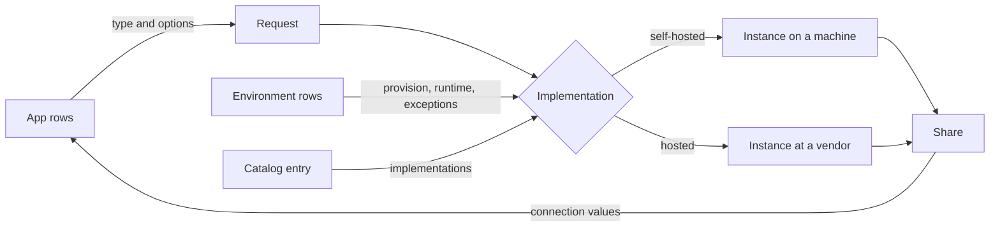

# [TARGET_ARCHITECTURE]

Design of a new product in its own repository: packages that declare every part of a backend in code and reconcile it without hand-run commands. Scope is macOS and Linux. Tool choice belongs to a separate review, and tools appear here as evidence alone. Bracketed numbers cite rows of section 17.

## [01]-[VERDICT]

Every part of the described product runs in production somewhere, and no system found joins all parts:
- Requests separated from implementations chosen per environment exist in Radius, Score, Crossplane, and Humanitec [01] [02] [03] [04]
- App models written in a general-purpose language exist in Aspire, Encore, and SST [05] [06] [07]
- Machines declared whole in code exist in NixOS, with unattended install and deployment by Git push [08] [09] [10]
- PostgreSQL with extensions, pooling, and backup preset exists in Pigsty and CloudNativePG [11] [12]
- One definition feeding development, test, and deployment exists in Aspire and Encore [05] [06]
- Reconciliation without typed commands exists in comin, Crossplane, and Pulumi Deployments [03] [09] [20]
- Values of one module accepted by a field of another, with no glue module, exist in Dagger [13]

Limits of each system decide what remains to build:
- Radius, Crossplane, and CloudNativePG run on Kubernetes and declare in YAML, and Score declares in YAML and applies nothing [01] [02] [03] [11]
- Aspire and Encore model app and resources, and no page read of either declares a rented machine or repository settings [05] [06]
- NixOS covers machine and services in Nix, hosted vendors and repository settings sit outside it [08]
- Pigsty covers PostgreSQL on Linux through Ansible inventory files [12]

Unbuilt part: typed packages that together hold account resources, machines, a catalog with a self-hosted and a hosted implementation per type, apps, sandboxes, and test services, on rented Linux machines with a cluster or without one. Section 14 states its cost.

## [02]-[TERMS]

Words for each part, each with its field term and source:

| [INDEX] | [PLAIN_WORD]              | [FIELD_TERM]          | [MEANING]                                                     | [SOURCE]  |
| :-----: | :------------------------ | :-------------------- | :------------------------------------------------------------ | :-------- |
|  [01]   | Host, VPS                 | Machine               | Linux system with an address, rented or owned                 | [17]      |
|  [02]   | Container for a tool      | Application container | One prebuilt program per container                            | [15]      |
|  [03]   | Container as a sandbox    | System container      | Full Linux distribution sharing a kernel with its machine     | [15]      |
|  [04]   | Database and its kind     | Backing service       | Service an app consumes over a network                        | [21]      |
|  [05]   | Kind of thing             | Resource type         | Interface a request names, with inputs and connection outputs | [01]      |
|  [06]   | Self-hosted or hosted     | Implementation        | How one resource type is made in one place                    | [01] [22] |
|  [07]   | Who supplies it           | Capability provider   | Vendor or own machine behind an implementation                | [22]      |
|  [08]   | Whole set of ready things | Catalog               | Resource types with their implementations                     | [11]      |
|  [09]   | App                       | Workload              | Built program with its resource requests                      | [02]      |
|  [10]   | Where it runs             | Compute environment   | Target that takes workloads (machine group, vendor functions) | [05]      |
|  [11]   | Setup for a purpose       | Environment           | Named place with its implementation choices                   | [01]      |
|  [12]   | How long a thing stays    | Lifetime              | Session, persistent, or bound to a parent                     | [05]      |
|  [13]   | Making reality match      | Reconciliation        | Agent observes actual state and applies desired state         | [23]      |
|  [14]   | Reality moved             | Drift                 | Gap between actual resources and recorded state               | [20]      |
|  [15]   | Nginx and its kind        | Reverse proxy         | Server that takes public requests and forwards each to an app | [31]      |
|  [16]   | Site                      | Route                 | Host name and path sent to one app port, with its certificate | [02]      |
|  [17]   | Background process        | Daemon                | Process a supervisor starts, keeps running, and stops         | [42]      |
|  [18]   | Background work of an app | Worker process        | Process type that handles tasks apart from HTTP requests      | [39]      |

Radius calls an implementation a recipe, Score a provisioner, Humanitec a resource definition, and Crossplane a composition [01] [02] [03] [04]. Account resource is a description coined here for repository, DNS zone, private network, and secret-store project, as no source read gives one term for them.

Twelve-factor states the central split: app code makes no distinction between a locally run service and a third-party one, and a deploy swaps one for another by changing a resource handle in config [21]. CNCF states the same for a platform: providers maintain backing implementations, and a platform is a thin consistent layer over them [22]. Score draws the remaining line between workload configuration an app owns and infrastructure configuration a platform owns [02].

## [03]-[PACKAGES]

Packages of this product, each usable alone:

| [INDEX] | [PACKAGE]  | [HOLDS]                                                     | [RUNS]                    | [PRODUCES]                      |
| :-----: | :--------- | :---------------------------------------------------------- | :------------------------ | :------------------------------ |
|  [01]   | Builder    | Levels, implementation choice, state units, reconcile entry | At deploy                 | Plans, state, connection values |
|  [02]   | Catalog    | Resource types, members, defaults                           | Read as data              | Type definitions                |
|  [03]   | Containers | Container definition with defaults, engine and its endpoint | Deploy, development, test | Container values                |
|  [04]   | Daemons    | Daemon declaration and operating system supervisors         | On a computer or machine  | Daemon values                   |
|  [05]   | Workers    | Handler kinds and one entry per compute environment         | Inside an app             | Process values                  |
|  [06]   | Fixtures   | Start of catalog containers for one test run                | Inside a test             | Connection values               |
|  [07]   | Operations | Connect, logs, run, sandbox, and plan by name               | On a computer             | Sessions and reports            |
|  [08]   | Vendors    | One package per vendor: machines, code host, DNS, secrets   | At deploy                 | Implementations and credentials |

Rules that keep packages apart:
- No package imports logic of another: workers know nothing of infrastructure, and daemons know nothing of containers
- Packages join through fields alone: a field of one shape accepts a value another package produces
- Values are plain data (a daemon value, a container value, a process value) that any code can construct without its producing package
- Each field has a default, and a consumer of one package never installs another to use it
- Core packages take paths, credentials, and build outputs from their caller and name no build tool or CI system
- Vendor packages hold each integration (a machine vendor, a code host, a DNS host, a secret store), and a consumer installs those it uses
- Consumers write rows that name a vendor package, never an adapter for a vendor

Fields that join them:

| [INDEX] | [SHAPE]                         | [FIELD]     | [ACCEPTS]       | [DEFAULT]                              |
| :-----: | :------------------------------ | :---------- | :-------------- | :------------------------------------- |
|  [01]   | App of builder                  | `processes` | Process values  | One `web` process                      |
|  [02]   | Instance and process of builder | `daemon`    | Daemon value    | Start with engine, restart always      |
|  [03]   | Engine of containers            | `daemon`    | Daemon value    | Start on first use, restart on failure |
|  [04]   | Catalog member                  | `container` | Container value | None, each member states one           |
|  [05]   | Fixture                         | `container` | Container value | Container of a catalog member          |
|  [06]   | Environment of builder          | `machines`  | Machine names   | None                                   |

Precedent for that form:
- Dagger modules accept a `Service` or `Container` of another module through a constructor argument, with no glue module [13]
- Aspire adds each resource kind as its own package (`Aspire.Hosting.PostgreSQL`) beside one AppHost file [05]
- Radius keeps resource types and recipe packs apart from environments [01]
- NixOS keeps modules in nixpkgs apart from a machine's configuration [08]

Consumers hold rows and nothing else. A consuming repository states account, machine, and environment rows in one place and app rows beside each app, and each change edits one file:
- New machine: one machine row
- New environment: one environment row
- New app: rows in its own folder
- New member of a category: one catalog module
- Self-hosted to hosted: one word, or one exception row
- Engine to cluster: one word, with data moved as section 14 states

Logger setup is a fair comparison for every package. A program configures its logger once where it starts, and code logs through one interface without knowing a destination. Here a caller states values once, and code that needs a machine, a container, a daemon, or a worker receives one configured.

## [04]-[LEVELS]

Levels of builder and what a declaration at each one states:

| [INDEX] | [LEVEL]     | [STATES]                                                     | [DEPENDS_ON]       |
| :-----: | :---------- | :----------------------------------------------------------- | :----------------- |
|  [01]   | Account     | Repository, DNS zones, private network, secret-store project | Vendor credentials |
|  [02]   | Machine     | Name, vendor, size, region, base system                      | Account            |
|  [03]   | Environment | Name, machines, runtime, provision default, exception rows   | Machines, catalog  |
|  [04]   | Instance    | One running resource of a type (PostgreSQL server `main`)    | Environment        |
|  [05]   | App         | Build output, processes, and requests                        | Environment        |

Rules that separate levels:
- Machines hold capacity alone, a machine row names no service
- Environments place instances on machines or at vendors, and an environment with one machine places every self-hosted instance there
- Apps request a share of an instance (database on a server, bucket in a store, key prefix in a cache), never a server
- Environments own instances, and an instance outlives every app that takes a share of it
- Catalog entries hold every setting a writer never repeats (version policy, ports, sockets, roles, tuning, backup, metrics)
- Each level reads outputs of its dependency alone: apps read connection values, instances machine facts, machines account facts

Score separates share from server in its default provisioners: `postgres` provisions a database on a shared instance and `postgres-instance` a dedicated instance [02].

Ten machines for unrelated purposes are ten machine rows and as many environments as purposes, since an environment groups machines with implementation choices [01]. Placement is a field (`on: '<machine>'`) with a derived default, and its type is the set of machine names rows declare. Swapping a machine edits that one value, and a hundred machine rows are a hundred values that field accepts.



## [05]-[DECLARATIONS]

Snippets show shape alone in TypeScript, and language and names stay open under question [04] of section 15. `<name>` stands for a value a writer chooses.

Account, declared once:

```typescript
account({
    repository: { visibility: 'public', merge: 'squash' },
    zones: ['<domain>'],
    network: { ssh: true },
});
```

Machines, one row each:

```typescript
machine('<machine>', { vendor: '<vendor>', size: '<plan>', region: '<region>' });
machine('<machine>', { vendor: '<vendor>', size: '<plan>', region: '<region>' });
```

Environment, with its switches and rows for exceptions:

```typescript
environment('production', {
    machines: ['<machine>'],
    runtime: 'engine',
    provision: 'self-hosted',
    types: {
        objectStorage: { implementation: '<vendor>' },
        backup: { implementation: '<vendor>' },
    },
});
```

App, beside its code:

```typescript
app('<app>', {
    needs: {
        DB: postgres({ extensions: ['vector', 'postgis'] }),
        FILES: bucket({ expire: { '<prefix>': Duration.weeks(1) } }),
        CACHE: cache(),
    },
    allowed: ['<address>'],
});
```

Catalog entry, written once per type:

```typescript
resourceType('postgres', {
    share: 'database',
    outputs: ['url', 'migratorUrl'],
    default: { 'self-hosted': { engine: 'container', cluster: 'operator' }, hosted: '<vendor>' },
    implementations: { container, operator, '<vendor>': vendor },
});
```

Implementation choice for a request follows one order, most specific winning:
1. Row for its type under `types` of an environment
2. `provision` and `runtime` of that environment, mapped through `default` of its catalog entry
3. Sole implementation of a type that has one, where `provision` has no effect

Radius applies that order to parameters, environment values overriding recipe-pack values, and Humanitec to definitions, most specific criteria winning [01] [04].

Consequences for a writer:
- App rows never name an implementation, vendor, machine, port, or credential
- One edited word moves every type of an environment between self-hosted and hosted, and a row under `types` moves one type
- Options an implementation lacks fail planning with type, option, and implementation named, before any change applies
- Outputs carry connection values under names an app chose (`DB`, `FILES`)
- Types left out of every app and every environment create nothing

Tool configuration is output of builder. Aspire emits `docker-compose.yaml` from its app model as a publish artifact, and no person writes that file [05]. Generated YAML, INI, or XML that code never reads back satisfies a no-YAML requirement, and hand-written YAML that code parses does not.

## [06]-[CATALOG]

Capabilities divide by who asks for them. An app requests a share of some, and an environment holds others for every app:

| [INDEX] | [CAPABILITY]        | [ASKED_BY]  | [DEFAULT_TYPE]       | [SHARE]            | [RUNS_AS]         |
| :-----: | :------------------ | :---------- | :------------------- | :----------------- | :---------------- |
|  [01]   | Relational database | App         | PostgreSQL           | Database and roles | Server            |
|  [02]   | Embedded database   | App         | SQLite               | File on a volume   | Library in app    |
|  [03]   | Embedded analytics  | App         | DuckDB               | File or memory     | Library in app    |
|  [04]   | Analytical database | App         | ClickHouse           | Database and user  | Server            |
|  [05]   | Object storage      | App         | S3 interface         | Bucket and key     | Server or vendor  |
|  [06]   | Cache               | App         | Valkey               | Key prefix         | Server or vendor  |
|  [07]   | Queue or stream     | App         | None until requested | Topic              | Server or vendor  |
|  [08]   | Ingress and TLS     | Environment | Reverse proxy        | Route per app      | Server or vendor  |
|  [09]   | Identity            | Environment | Forward auth         | Policy per app     | Server or vendor  |
|  [10]   | Telemetry           | Environment | OTLP collector       | Endpoint for all   | Server or vendor  |
|  [11]   | Backup              | Environment | Object storage       | Path per instance  | Vendor or machine |
|  [12]   | Secrets             | Environment | Secret store         | Named values       | Vendor            |
|  [13]   | DNS                 | Account     | Zone                 | Records per route  | Vendor            |

Placement of products that prompt category questions:
- PostgreSQL is sole default of its category, and a document or key-value store is a separate category that stays empty until an app requests it
- DuckDB belongs beside SQLite, not beside PostgreSQL or ClickHouse: it runs inside its host process and targets analytical queries [27]
- Embedded databases have no instance, and their catalog entries supply a volume and a backup path alone
- ClickHouse is a server for analytical queries, and one use of it is storage behind telemetry
- Metrics, logs, and traces are one capability an environment holds, and apps reach it through one OTLP endpoint
- Telemetry storage engines are internal to an implementation of that capability
- Victoria is an alternative storage implementation for telemetry: Pigsty builds its monitoring on Victoria with Grafana [12]
- Backup is no app request: each stateful implementation states how it backs up, and an environment states where
- Domains, DNS, and machines are infrastructure that resources and apps stand on

Nginx belongs to row [08], and it defines neither a machine nor a site:
- Nginx is an HTTP web server, reverse proxy, content cache, load balancer, and TCP/UDP proxy [31]
- Its category is ingress: one instance per environment receives public traffic, ends TLS, and forwards each request to an app
- Traefik and Caddy are members of that row, Caddy holds it in Uncloud [17], and a vendor proxy in front of a machine is its hosted implementation
- Sites are shares of that instance, as databases are shares of a server: Score names one `route` on a shared Nginx instance [02]
- App rows state no proxy configuration: name, port, and `allowed` list yield route, certificate, and access policy
- Machines are capacity under that instance, and replacing Nginx with another member changes one implementation and no app row
- Static files are a workload kind served by that same proxy, with an app row naming a folder in place of a port
- Caching and load balancing are settings of an ingress implementation, never separate rows an app requests

Redis belongs to row [06], and it is set at each level with one meaning per level:
- Redis is a product, and its category is cache: a data structure server serving key-value workloads over a network [41]
- Valkey is that row's default member, forked from Redis before Redis changed license [41]
- Catalog level states its type once: interface (Redis protocol), members, memory limit, eviction, and persistence
- Environment level states which member serves it and where, by `provision` or by one exception row
- App level states one row (`CACHE: cache()`) and receives an address, a credential, and a key prefix
- That row is identical for self-hosted and hosted members, and no field of it exists for one side alone
- Hosted counterpart is any vendor service that speaks its protocol, reached by an exception row of an environment
- Durable key-value data (sessions, locks, job state) is a separate request with backup, since eviction and durability conflict in one instance

Rows with one member need no selection, and rows with a default need none either. Selection appears only as an exception row under `types`.

Members enter a category by one rule, which keeps each default replaceable:
- Each category holds one default and any count of alternatives, each written once against its type interface
- Entry needs an open license, a release inside one year, its category's common interface, and a stated backup path
- Each member states which runtimes of section 07 it supports and whether it runs on one machine, many, or both
- Defaults change by one edited row of a catalog entry, and no app or environment row changes with it
- Members with an archived repository leave their category

Object storage shows why that rule exists. MinIO's repository is archived, and its README states it is no longer maintained [35]:

| [INDEX] | [MEMBER]  | [LICENSE]  | [NEWEST_RELEASE]     | [STATED_SCOPE]                                            | [SOURCE] |
| :-----: | :-------- | :--------- | :------------------- | :-------------------------------------------------------- | :------- |
|  [01]   | RustFS    | Apache-2.0 | `1.0.5`, 2026-11-10  | Single node and distributed modes, lifecycle, replication | [33]     |
|  [02]   | Garage    | AGPL-3.0   | Tag `v2.5.0`         | Clusters of nodes at separate sites, small to medium size | [32]     |
|  [03]   | SeaweedFS | Apache-2.0 | `4.53`, 2026-11-08   | One binary serving S3, POSIX files, and S3 Tables         | [34]     |
|  [04]   | MinIO     | AGPL-3.0   | 2025-10-16, archived | Unmaintained                                              | [35]     |

Garage is an S3-compatible object store built for self-hosting across machines at different sites [32]. Choosing a default among members is measurement against entry criteria on a target machine, and that selection belongs to tool review for every category.

Contents a catalog entry fixes for PostgreSQL, as an example of everything set once:

| [INDEX] | [CONCERN]  | [PRESET]                                                                |
| :-----: | :--------- | :---------------------------------------------------------------------- |
|  [01]   | Version    | Major pinned in entry, minor follows upstream                           |
|  [02]   | Extensions | Named set available, each app row enables members by name               |
|  [03]   | Transport  | Unix socket on one machine, TLS across machines, vendor TLS when hosted |
|  [04]   | Pooling    | Pooler in front of every runtime connection                             |
|  [05]   | Roles      | Migrator owns schema, runtime holds data privileges alone               |
|  [06]   | Tuning     | Memory settings computed from machine size                              |
|  [07]   | Backup     | Continuous archive and scheduled base backup to environment target      |
|  [08]   | Telemetry  | Statement statistics and slow-plan logging on                           |

Evidence that such an entry is an existing product class:
- Pigsty packages PostgreSQL with 575 extensions, pooling, point-in-time recovery, and monitoring preset [12]
- CloudNativePG mounts each extension as its own image, a catalog holds image references, and a cluster enables an extension by name [11]
- NixOS takes `services.postgresql.extensions` as a list of names and builds a matching server package with no Dockerfile [08]

Version policy has a hard limit. A PostgreSQL major upgrade needs a dump and reload or `pg_upgrade`, since data directory format changes between majors [24]. NixOS for that reason sets its major explicitly and never floats it [08]. A catalog entry lets minor versions follow upstream and treats a major change of a stateful type as a planned operation.

Images without Dockerfiles have precedent in each route: packages composed by name in Nix [08], extension images mounted beside an unchanged base image [11], and containers built through an API in code [13].

## [07]-[RUNTIMES]

Tools that run containers sit at separate levels, and each level has its own chooser:

| [INDEX] | [TOOL]        | [IS]                                                   | [LEVEL]             | [CHOSEN_BY]       | [SOURCE] |
| :-----: | :------------ | :----------------------------------------------------- | :------------------ | :---------------- | :------- |
|  [01]   | Docker Engine | Daemon `dockerd`, its API, and client `docker`         | Machine base system | Fixed             | [40]     |
|  [02]   | Colima        | Virtual machine on a Mac running Docker by default     | Developer computer  | Operating system  | [36]     |
|  [03]   | Kubernetes    | Platform managing containerized workloads across nodes | Environment runtime | Environment field | [37]     |
|  [04]   | K3s           | Kubernetes distribution in one binary                  | Environment runtime | Environment field | [38]     |

Docker is the one engine. Its client reaches a daemon through an endpoint, and a context holds everything one client needs to manage one daemon [40]. An operating system decides only where that daemon runs and which endpoint reaches it:

| [INDEX] | [COMPUTER]       | [DAEMON_RUNS]                        | [ENDPOINT]                         |
| :-----: | :--------------- | :----------------------------------- | :--------------------------------- |
|  [01]   | Linux            | On that computer                     | `unix:///var/run/docker.sock` [40] |
|  [02]   | Mac              | Inside Colima's virtual machine [36] | Socket of that virtual machine     |
|  [03]   | Deployed machine | On that machine                      | One context per machine [40]       |

Developer computers are Macs and Linux computers, and every machine is Linux. Row [02] of both tables is for that reason never a setting of a backend. Colima's own defaults are 2 CPUs and 2 GiB memory, its default runtime is Docker, and a Docker client works after `colima start` with no further setup [36].

No Docker profile exists for a consumer to select. Differences divide by owner, and each owner states its part once:

| [INDEX] | [DIFFERENCE]                               | [OWNER]                                  |
| :-----: | :----------------------------------------- | :--------------------------------------- |
|  [01]   | Endpoint of a daemon                       | Derived from computer or machine row     |
|  [02]   | Size, mounts, and ports of a guest system  | Engine shape of containers package       |
|  [03]   | Daemon settings of a deployed machine      | Machine base system of builder           |
|  [04]   | Logging, restart, health, stop, and limits | Container defaults of containers package |
|  [05]   | Image, values, and exceptions              | Consumer                                 |

Consequences for code that creates a container:
- Consumers pass an image and values, and receive every default of rows [03] and [04] without stating one
- Package code reads its endpoint from its caller's environment or from a machine row, and no consumer names a socket
- Defaults hold features every endpoint supports, and a feature one guest system lacks fails planning with that system named
- One container definition runs unchanged on Linux, under Colima, and on a deployed machine
- Each machine row yields one endpoint in state, and a developer computer is one more machine with an endpoint derived from its operating system

Cluster or not is one field of an environment:

```typescript
environment('<name>', {
    machines: ['<machine>', '<machine>'],
    runtime: 'cluster',
    provision: 'self-hosted',
});
```

Values of `runtime`:
- `engine` — each machine runs Docker Engine, and an environment row places each instance on a named machine
- `cluster` — machines join as nodes, and a scheduler places, restarts, and replaces containers [37]

Rules that keep runtimes from mixing:
- Runtime is stated once per environment, never per machine, instance, or app
- Self-hosted implementations exist per runtime: PostgreSQL is a container with a pooler under `engine` and an operator-managed cluster under `cluster` [11]
- Hosted implementations ignore runtime
- Implementation choice reads type, then provision, then runtime
- Machines take their base system from runtime: Docker Engine under `engine`, node software under `cluster`
- App rows are identical under both values, and options that need a scheduler (replicas spread across machines) fail planning under `engine`
- One environment holds one runtime, and separate environments can differ
- `cluster` over one machine is valid: K3s runs every control plane component in one process [38]
- Nodes under `cluster` take a container runtime from their distribution, as K3s packages containerd [38], and no Docker row applies to them
- Local environment is `engine` on a developer computer, with its daemon and endpoint derived from that computer's operating system

Kubernetes for that reason sits beside no other part of a backend. It is neither a backing service nor a machine: it is how an environment runs every self-hosted thing, stated once and read by each catalog implementation. Writers of app rows never see it.

Precedent for one field with identical app rows: Score generates Compose files or Kubernetes manifests from one workload file [02], Aspire calls its target a compute environment and requires explicit binding when one model holds more than one [05], and a Radius environment names its namespace or cluster [01].

## [08]-[DAEMONS]

Daemons are processes that a supervisor starts, keeps running, and stops. Each level has its own supervisor:

| [INDEX] | [LEVEL]          | [SUPERVISOR]         | [KEEPS_RUNNING]                              | [SOURCE] |
| :-----: | :--------------- | :------------------- | :------------------------------------------- | :------- |
|  [01]   | Mac              | `launchd`            | Agent per logged-in user, daemon per system  | [42]     |
|  [02]   | Linux computer   | `systemd`            | Service unit                                 | [43]     |
|  [03]   | Machine          | `systemd`            | Service unit, Docker's daemon among them     | [43]     |
|  [04]   | Container engine | Docker's daemon      | Container, by restart policy                 | [44]     |
|  [05]   | Cluster          | Workload controllers | Pods of a Deployment, StatefulSet, DaemonSet | [45]     |

What each source states:
- `launchd` starts daemons on demand, continuously, or at timed intervals, and an agent runs only while its user is logged in [42]
- Service units of `systemd` describe a process systemd controls and supervises, and `Restart=` states whether it restarts after exit [43]
- Docker restarts a container by policy (`no`, `on-failure`, `always`, `unless-stopped`) and advises against process managers for containers [44]
- Kubernetes controllers keep a stated count of pods running, and a DaemonSet runs one pod on every matching node [45]

Supervisors nest. On a machine `systemd` keeps Docker's daemon running and that daemon keeps containers running, and on a Mac `launchd` keeps a guest system running that holds both.

Daemons package holds one declaration, and it is no part of builder:

```typescript
daemon('<name>', {
    run: ['<program>', '<argument>'],
    start: 'login',
    restart: 'on-failure',
    ready: { check: ['<program>', '<argument>'], within: Duration.minutes(5) },
    stop: { signal: 'SIGTERM', within: Duration.minutes(5) },
    logs: { keep: Duration.days(7) },
});
```

Fields of that declaration and what each becomes:

| [INDEX] | [FIELD]   | [VALUES]                        | [MAC]              | [LINUX]            | [ENGINE]          | [CLUSTER]          |
| :-----: | :-------- | :------------------------------ | :----------------- | :----------------- | :---------------- | :----------------- |
|  [01]   | `run`     | Program or container            | Agent or daemon    | Service unit       | Container         | Pod template       |
|  [02]   | `start`   | Boot, login, first use, by hand | Load or on demand  | Install target     | With its daemon   | On apply           |
|  [03]   | `restart` | Never, on failure, always       | Keep-alive setting | `Restart=`         | Restart policy    | Controller         |
|  [04]   | `ready`   | Check and time limit            | Check by package   | Check by package   | Health check      | Probe              |
|  [05]   | `stop`    | Signal and time limit           | Stop by package    | Unit stop settings | Stop grace period | Termination period |
|  [06]   | `logs`    | Retention                       | File with rotation | Journal            | Logging driver    | Node log settings  |

Owner of each column:
- Daemons package writes `launchd` and `systemd` files, and runs alone in a project that needs a background process and no backend
- Containers package reads a daemon value into restart policy, health check, and stop settings of a container
- Builder reads a daemon value into workload settings under `cluster`
- Each reader takes that value as plain data through its own field, and none imports daemons package

Rules for a consumer:
- Consumers state values of those fields and never name a supervisor, a unit file, or a property list
- Every field has a default, and a daemon stated with `run` alone is complete
- Supervisor files are generated output, as decision [06] of section 15 states for every tool file
- Values a supervisor cannot express (`login` under `cluster`) fail planning with field, value, and level named
- Project-specific choices are values (start at login, size, time limits), and every mechanism is written once

Shapes that run continuously accept a daemon value with defaults that fit them:

| [INDEX] | [SHAPE]          | [PACKAGE]  | [DEFAULT_START] | [DEFAULT_RESTART] | [CONSUMER_PASSES]                    |
| :-----: | :--------------- | :--------- | :-------------- | :---------------- | :----------------------------------- |
|  [01]   | Engine on a Mac  | Containers | First use       | On failure        | Size of guest system, start at login |
|  [02]   | Engine on Linux  | Containers | Boot            | Always            | Nothing                              |
|  [03]   | Service instance | Builder    | With its engine | Always            | Stop time limit of a slow store      |
|  [04]   | App process      | Builder    | With its engine | Always            | Nothing                              |
|  [05]   | Worker process   | Builder    | With its engine | Always            | Stop time limit for work in progress |
|  [06]   | Reconcile agent  | Builder    | Boot            | Always            | Poll interval                        |
|  [07]   | Sandbox          | Operations | By hand         | Never             | Expiry                               |

```typescript
engine({ cpus: 4, memory: ByteSize.gibibytes(8), daemon: { start: 'login' } });
```

## [09]-[WORKERS]

Worker names separate things, and neither is a catalog category:
- Worker process is a process type of an app: twelve-factor gives HTTP requests to a web process and background tasks to a worker process [39]
- Vendor function platforms (Cloudflare Workers) are hosted compute environments
- Worker code is app code written against workers package, and no app requests a worker as a backing service

Workers package is a product of its own and knows nothing of infrastructure:
- It holds handler kinds (request, queue message, schedule) with delivery and schedule values that name no vendor
- It holds one entry per compute environment (a vendor's function runtime, a long-running process), each written once
- Retry, acknowledgment, shutdown, and telemetry sit in each entry, and no app hand-writes them
- App code states handlers once and runs under any entry
- It exports a process value: name, entry, and triggers, as plain data

Builder accepts that value through `processes` of an app and derives everything else:

| [INDEX] | [TRIGGER]     | [PROCESS_VALUE]            | [HOSTED]                  | [SELF_HOSTED]                      |
| :-----: | :------------ | :------------------------- | :------------------------ | :--------------------------------- |
|  [01]   | HTTP request  | Process `web`              | Vendor function handler   | Process behind ingress             |
|  [02]   | Queue message | Queue name on a process    | Vendor queue and consumer | Queue share, process with no route |
|  [03]   | Schedule      | Schedule text on a process | Vendor timer              | Timer of machine or cluster        |

Configuration of a worker is small and not empty:
- Process values state that a process exists, since nothing else tells a machine to start it
- Trigger values state a queue or schedule
- Requests of that process are `needs` rows of its app, shared with every other process of that app
- Image, restart policy, credentials, telemetry endpoint, and queue address are derived, and no row states them
- Workers have no settings beyond those values

Redis is no requirement of a worker. A queue trigger needs a member of row [07] of section 06, and a cache member can serve as that member where it supports durable delivery. An app that uses workers package with no builder supplies those addresses by hand, and an app that uses builder with no workers package states process values directly.

Encore shows declared triggers in production: an app declares Pub/Sub topics and cron jobs in code, runs them in memory locally, and gets vendor queues when deployed [06].

## [10]-[LIFETIMES]

Lifetime belongs to an instance, never to a type. One catalog entry serves every row below:

| [INDEX] | [KIND]              | [CREATED_BY]        | [ENDS_WHEN]               | [DATA]                 | [STATE_UNIT]        |
| :-----: | :------------------ | :------------------ | :------------------------ | :--------------------- | :------------------ |
|  [01]   | Account resource    | Reconcile           | Never, removal is refused | Protected              | Account             |
|  [02]   | Machine             | Reconcile           | Row removed and retired   | On volumes and backups | One per machine     |
|  [03]   | Service instance    | Reconcile           | Row marked retired        | Outlives versions      | One per environment |
|  [04]   | App release         | Reconcile on merge  | Next release replaces it  | In its shares          | One per app         |
|  [05]   | Preview app         | Pull request opened | Pull request closed       | Disposable             | One per preview     |
|  [06]   | Sandbox             | One command         | Stated expiry             | Disposable             | One per sandbox     |
|  [07]   | Development service | Development command | Session end, or kept      | Disposable             | None                |
|  [08]   | Test service        | Test process        | Test run end              | None                   | None                |

Reasons for each boundary:
- State units follow lifetimes, since a plan for one unit cannot destroy members of another
- Removing a stateful row never deletes data: removal marks an instance retired, and deletion is a separate stated act
- Rows [05] and [06] differ from [04] by expiry alone
- Rows [07] and [08] never enter infrastructure state, which keeps a failed test or closed editor from changing a state unit
- Aspire names lifetimes of [07]: session ends with its host process, persistent survives it and is recreated when configuration changes [05]

Row [06] is a container made on a whim, designed as follows:
- One command takes a catalog type or an image, a name, and an expiry, and returns connection values
- Its state unit holds that sandbox alone, outside every environment
- Expiry is required, and a scheduled reconcile run destroys expired sandboxes
- No sandbox receives production credentials or a share of a production instance
- Sandboxes for installing tools are system containers or virtual machines, and a sandbox of one service is an application container [15]

Existing forms of each part: Coder creates workspaces from templates and stops or deletes idle ones [14], Incus deletes an ephemeral instance when it stops [15], and Pulumi destroys a stack at a stated time [20]. Dormancy deletion in Coder and time-to-live stacks in Pulumi are paid features [14] [20], which leaves expiry to a scheduled run of this product.

## [11]-[TESTS]

Rules for test services:
- Test services have test lifetime: a test process creates and removes them, and no state unit knows them
- Tests of code against a server run the catalog image for that type, with its extensions and settings
- Tests never reach a development or deployed instance
- Test dependencies enter a project with their first importing test

Choice by what a test needs:

| [INDEX] | [TEST_NEEDS]                             | [USES]                                          |
| :-----: | :--------------------------------------- | :---------------------------------------------- |
|  [01]   | Logic alone                              | No service                                      |
|  [02]   | SQL with no extension or server behavior | In-process engine                               |
|  [03]   | Database on a production-like server     | One server per run, one fresh database per test |
|  [04]   | Control of a server process              | One container per test                          |

Evidence per row:
- Row [02]: PGlite is PostgreSQL compiled to WASM inside a client library, started and discarded per test [26]
- Row [03]: Encore creates separate test databases with `fsync` off and in-memory files [06]
- Row [03]: Testcontainers restores a PostgreSQL snapshot between tests [19]
- Row [03]: Aspire starts its whole app model for a test on random ports and removes it on dispose [05]
- Row [04]: tests that pause a server or cut its network need an engine that owns each container

Testcontainers fits rows [03] and [04] as an engine: containers are declared in test code, and a reaper container removes leftovers [19]. Its stock modules start whatever image a test names [19], which makes a catalog image usable without a second definition. GitHub service containers fail the requirements: they are workflow YAML, need a Linux runner, and exist in CI alone [25].

Fixtures package: each catalog member exposes its container value (image reference, environment, readiness check), and a fixture per language starts it through that language's Testcontainers `GenericContainer`. A catalog in one language serving tests in others is question [04] of section 15.

## [12]-[RECONCILIATION]

OpenGitOps states four properties: desired state is declarative, versioned and immutable, pulled automatically, and continuously reconciled [23].

Path from a declaration to reality:
1. Pull requests change rows, and CI plans every affected state unit and posts each plan
2. Merge to a main branch applies those plans in dependency order: account, machines, environments, apps
3. Scheduled runs refresh every unit, report drift, and destroy expired previews and sandboxes
4. Failed applies leave their unit at its last applied state and fail their run

No person types a deploy command on that path. Pulumi offers scheduled drift detection with remediation as a paid feature [20], and its CLI runs a preview-only refresh that a scheduled workflow can call [20].

One entry serves every caller. Local development, CI, and scheduled runs call it with an environment name, and nothing is done once in a workflow file, again in a shell script, and again in a build tool.

Operations package takes a name and nothing else:

| [INDEX] | [OPERATION] | [INPUT]                   | [DERIVED_FROM_STATE]                         |
| :-----: | :---------- | :------------------------ | :------------------------------------------- |
|  [01]   | Connect     | Machine or instance name  | Address, user, key, host key, client program |
|  [02]   | Logs        | Machine, instance, or app | Log source and time range default            |
|  [03]   | Run         | Name and command          | Same as connect                              |
|  [04]   | Sandbox     | Type or image, expiry     | Machine with capacity, connection values     |
|  [05]   | Plan        | Nothing or one unit name  | Affected units                               |

Starting from nothing has an irreducible manual part:
- One person opens vendor accounts and creates one credential in each
- That person places each credential in one secret store and names one state store
- Bootstrap unit creates secret-store configs, repository settings, and CI identity from those credentials
- Reconciliation by CI takes every later change
- Bootstrap unit reads no value that it declares

Other systems carry such a step: nixos-anywhere needs SSH access to an existing machine [10], and Radius needs a Kubernetes cluster for its control plane [01].

Push and pull are both in use. CI pushing over a private network gives declarative, versioned, and scheduled reconciliation. Pull needs an agent on each machine: comin polls a Git repository from each NixOS machine and deploys a commit within 60 seconds [09]. Uncloud takes the opposite position and prefers imperative operations over reconciliation [17]. Question [02] of section 15 holds that choice.

## [13]-[PRIOR_SYSTEMS]

Search covered systems found by description through web search on 2026-11-12, then documentation of each row:

| [INDEX] | [SYSTEM]       | [PROVES]                                                      | [STOPS_AT]                               |
| :-----: | :------------- | :------------------------------------------------------------ | :--------------------------------------- |
|  [01]   | Radius         | Type as interface, recipe per environment                     | Kubernetes control plane, YAML and Bicep |
|  [02]   | Score          | Workload file with typed resource requests                    | YAML, generates files, applies nothing   |
|  [03]   | Crossplane     | Custom types over continuous reconciliation                   | Kubernetes, YAML                         |
|  [04]   | Humanitec      | Most specific definition wins per context                     | Vendor product                           |
|  [05]   | Aspire         | App model in C# or TypeScript for run, test, and deploy       | No machine or account level              |
|  [06]   | Encore         | Resources declared in app code, test databases                | Own framework, cloud through its service |
|  [07]   | SST            | Typed links from resource to runtime code                     | AWS and Cloudflare components            |
|  [08]   | NixOS          | Machine and services whole in code                            | Nix language, no vendor resources        |
|  [09]   | comin          | Pull reconciliation of machines from Git                      | NixOS and nix-darwin                     |
|  [10]   | nixos-anywhere | Unattended install over SSH                                   | Needs a reachable machine                |
|  [11]   | CloudNativePG  | Extensions by name from an image catalog                      | Kubernetes 1.33 or later, PostgreSQL 18  |
|  [12]   | Pigsty         | PostgreSQL distribution with presets                          | Ansible inventory, one capability        |
|  [13]   | Dagger         | Containers and services in code, values passed across modules | Pipeline lifetime                        |
|  [14]   | Coder          | Template once, instance per request, idle stop                | Development workspaces                   |
|  [15]   | Incus          | System container, application container, VM under one command | Imperative commands                      |
|  [16]   | Kamal          | Accessories on named machines                                 | YAML, accessories outside deploys        |
|  [17]   | Uncloud        | Machines joined without a control plane                       | Compose files, imperative by choice      |
|  [18]   | Dokploy        | Databases and apps on own machines                            | State in its database, dashboard first   |
|  [19]   | Testcontainers | Test-lifetime containers declared in test code                | Tests alone                              |
|  [20]   | Pulumi Cloud   | Scheduled drift runs, stacks with expiry                      | Paid tiers                               |

Nearest whole systems:
- Aspire with its Radius target joins an app model in code to recipes per environment, as a prototype that needs Kubernetes [05]
- NixOS with comin and nixos-anywhere covers machine, services, install, and reconciliation [08] [09] [10]
- NixOS lacks hosted implementations, account resources, and app requests

Aspire states its own boundary: it is no cloud provider or production runtime [05]. Its Docker Compose target writes files and applies them with a container runtime where its CLI runs [05].

## [14]-[COSTS]

Costs of the unbuilt part, each with its evidence:
- Catalogs are maintained products: each type and implementation is code that follows upstream releases and runs major upgrades [24]
- Shared interfaces narrow to what every implementation offers, and a feature of one vendor has no place in a shared row
- Changed rows move no data: twelve-factor swapping concerns app code [21], and moving a database between implementations is a migration
- Machines under `engine` have no scheduler, which leaves placement, restart, rolling replacement, and failover to builder
- Radius, Crossplane, and CloudNativePG stand on Kubernetes [01] [03] [11], and Score needs none and generates files without running them [02]
- One catalog language serves tests in every other language, and exported definitions must be generated to stay one source
- Each runtime an environment can state doubles self-hosted implementations of every member, and each added member multiplies them again
- Engine to cluster moves every stateful instance, which is a data migration and no row edit
- Separate packages need stable value shapes between them, and a changed shape is a release of every package that reads it
- Companies selling infrastructure derived from code closed or stalled: Wing Cloud shut down in April 2025 [28]
- Klotho published its newest release on 2024-08-21 [29]
- Aspire and Encore published releases in November and October 2026 [05] [06]

Scope that keeps cost bounded: types a first consumer requests, one self-hosted implementation each, one runtime, and a hosted implementation only where that consumer uses one.

## [15]-[DECISIONS]

Decided, each with its reason:

| [INDEX] | [DECISION]                                                    | [REASON]                                            |
| :-----: | :------------------------------------------------------------ | :-------------------------------------------------- |
|  [01]   | Type, implementation, and instance are separate declarations  | Rows [01] to [04] of section 13 separate them       |
|  [02]   | Apps request shares, environments own instances               | Data outlives apps, shares isolate apps             |
|  [03]   | One provision switch per environment, exception rows per type | One choice stated once, most specific wins          |
|  [04]   | Lifetime sits on an instance                                  | One entry serves deploy, preview, sandbox, and test |
|  [05]   | Machine rows and every non-secret value sit in code           | Review, history, and types at edit time             |
|  [06]   | Tool files are generated and never parsed                     | Code is source, files are output                    |
|  [07]   | Merge applies, schedule checks drift, no hand deploy          | Every GitOps property but pull, without an agent    |
|  [08]   | Tests use test-lifetime services from catalog images          | Tested server equals deployed server                |
|  [09]   | Majors of stateful types are pinned                           | Data format changes between majors                  |
|  [10]   | App rows stay beside each app                                 | Adding an app edits its own file alone              |
|  [11]   | Runtime is one field of an environment                        | One statement configures every self-hosted member   |
|  [12]   | Product sits in its own repository                            | No convention of one consumer enters a package      |
|  [13]   | Categories hold a default and replaceable alternatives        | Members go unmaintained, as MinIO did               |
|  [14]   | Builder, catalog, containers, daemons, workers are packages   | Each is usable alone, as section 03 states          |
|  [15]   | Packages join through fields that accept plain values         | No package imports logic of another                 |
|  [16]   | Daemon is one declaration, supervisor follows placement       | Fields equal at every level, mechanisms differ      |
|  [17]   | Core packages name no build tool or CI system                 | Any project can import them with its own tools      |
|  [18]   | Docker is the one engine, on macOS and Linux alone            | One endpoint model, no second engine to implement   |
|  [19]   | Cache rows are identical for self-hosted and hosted           | App code makes no distinction between them          |
|  [20]   | Each vendor integration is a package of this product          | No consumer writes an adapter for a vendor          |

Open, each with what decides it:

| [INDEX] | [QUESTION]                    | [OPTIONS]                                                  | [DECIDED_BY]                                 |
| :-----: | :---------------------------- | :--------------------------------------------------------- | :------------------------------------------- |
|  [01]   | Runtime of first environments | `engine` alone, `cluster` alone, both implemented          | Machine count, need to move instances        |
|  [02]   | Push or pull                  | CI over private network, agent per machine                 | Tolerance for drift between scheduled runs   |
|  [03]   | Sandbox form and expiry       | Application container, system container, VM                | Share of sandboxes that install tools        |
|  [04]   | Package language              | One with generated exports, one per ecosystem              | Languages of first consumers and their tests |
|  [05]   | Machine creation              | Create through vendor API, adopt by name                   | Vendor API coverage                          |
|  [06]   | Telemetry storage default     | ClickHouse, Victoria                                       | Measured memory on smallest machine          |
|  [07]   | Local development services    | Catalog with session or persistent lifetime                | Start time of persistent instances           |
|  [08]   | Instance class in an app row  | Shared alone, shared or dedicated                          | First app needing isolation from other apps  |
|  [09]   | Self-hosted queue member      | Cache member with durable delivery, database table, broker | First app with a queue trigger               |
|  [10]   | Worker handler interface      | One neutral interface, one interface per vendor            | Count of apps running under more entries     |
|  [11]   | Home of shared value shapes   | Structural types per reader, one types-only package        | Package language and its type system         |

Question [01] decides most cost. Each runtime doubles self-hosted implementations of every member. `cluster` brings existing implementations (rows [01], [03], [11] of section 13) and its own operating weight, and `engine` keeps weight low and leaves scheduling to builder.

## [16]-[UNVERIFIED]

Claims not held to a full read or a direct check:
- Unverified: whether a given machine vendor's API creates and destroys machines, its API reference decides question [05]
- Unverified: whether extension images mount beside PostgreSQL on Docker Engine without Kubernetes, Docker's image mount reference decides it
- Unverified: whether a newer PostgreSQL 19 release exists than `19rc1`, eight Docker Hub tags were read and postgresql.org's release list decides it
- Unverified: memory use of ClickHouse against Victoria on a small machine, a measurement on that machine decides question [06]
- Unverified: whether Aspire's Docker Compose target applies to a remote machine, its Docker integration page decides it
- Unverified: absence of one system covering every level, which holds for rows of section 13 alone
- Unverified: what Humanitec runs on and how it is licensed, its product documentation decides it
- Unverified: which Pulumi plans include drift schedules and time-to-live stacks beyond those its pages name, its pricing page decides it
- Unverified: whether Garage runs on one machine and supports bucket lifecycle rules, its features page decides it
- Unverified: memory K3s needs on a small machine beside its workloads, a measurement on that machine decides it
- Unverified: best member per category, since members beyond object storage were not compared and tool review decides each
- Unverified: which vendors offer a hosted cache over the Redis protocol, each vendor product page decides it
- Unverified: whether Valkey gives durable queue delivery fit for question [09], its streams and persistence pages decide it
- Unverified: which Compose and BuildKit features differ between Colima and a Linux daemon, one build per system decides it
- Unverified: field table cells of section 08 beyond `Restart=`, restart policy, and controllers, which rest on no page read here
- Unverified: which `launchd` keys express restart on failure and start at login, `launchd.plist` manual page decides it
- Unverified: whether `colima start --foreground` runs cleanly as a direct `launchd` agent with no second supervisor, a trial on a Mac decides it
- Unverified: whether plain values suffice between packages in a language without structural types, a prototype in that language decides it
- Rows marked Excerpt or Partial in section 17 rest on less than a full read, and a full read of each page confirms or corrects them
- Nitric and tsdevstack appeared in search and were not read

## [17]-[SOURCES]

Pages read on 2026-11-12, each with its repository tag or commit where one exists and how much was read:

| [INDEX] | [SOURCE]                                      | [VERSION]                    | [READ]  |
| :-----: | :-------------------------------------------- | :--------------------------- | :------ |
|  [01]   | Radius concepts: types, recipes, environments | Docs `86b1e7bd49`, `v0.62.0` | Full    |
|  [02]   | Score overview and Compose provisioners       | Docs `c46073eedd`, `0.49.0`  | Full    |
|  [03]   | Crossplane introduction and compositions      | `v2.4`                       | Partial |
|  [04]   | Humanitec resource definitions                | Read date                    | Excerpt |
|  [05]   | Aspire documentation text file                | `v13.6.5`                    | Partial |
|  [06]   | Encore infrastructure config, testing, posts  | `v1.58.8`                    | Partial |
|  [07]   | SST linking and components                    | `v4.17.2`                    | Excerpt |
|  [08]   | NixOS manual, PostgreSQL chapter              | Branch `release-26.05`       | Partial |
|  [09]   | Readme of `comin`                             | `v0.14.0`                    | Full    |
|  [10]   | README of `nixos-anywhere`                    | `1.13.0`                     | Partial |
|  [11]   | CloudNativePG image volume extensions         | `v1.30.1`                    | Partial |
|  [12]   | Pigsty README                                 | `v4.5.0`                     | Partial |
|  [13]   | Dagger services page and API reference        | `v0.21.11`                   | Full    |
|  [14]   | Coder workspace lifecycle and schedules       | `v2.38.7`                    | Excerpt |
|  [15]   | Incus instance types, creation, properties    | `v7.6.0`                     | Full    |
|  [16]   | Kamal accessories                             | `v2.12.0`                    | Partial |
|  [17]   | Uncloud README                                | `v0.22.0`                    | Partial |
|  [18]   | Dokploy architecture and databases            | `v0.31.1`                    | Excerpt |
|  [19]   | Testcontainers for Node.js documentation      | `v12.2.1`                    | Partial |
|  [20]   | Pulumi time-to-live stacks and drift          | Read date                    | Partial |
|  [21]   | Twelve-Factor App, backing services           | 2017                         | Full    |
|  [22]   | CNCF Platforms White Paper                    | Read date                    | Partial |
|  [23]   | OpenGitOps principles                         | `v1.0.0`                     | Full    |
|  [24]   | PostgreSQL versioning policy                  | Read date                    | Partial |
|  [25]   | GitHub Docker service containers              | Read date                    | Partial |
|  [26]   | PGlite introduction                           | Read date                    | Full    |
|  [27]   | Why DuckDB                                    | Read date                    | Partial |
|  [28]   | Wing Cloud closure                            | 2025-04-09                   | Excerpt |
|  [29]   | Klotho releases                               | `v0.7.2`, 2024-08-21         | Full    |
|  [30]   | Docker Hub tags of `postgres`                 | Tags updated 2026-11-11      | Partial |
|  [31]   | Home page of nginx                            | Read date                    | Partial |
|  [32]   | Garage README and tags                        | Tag `v2.5.0`                 | Full    |
|  [33]   | RustFS README                                 | `1.0.5`                      | Partial |
|  [34]   | SeaweedFS README                              | `4.53`                       | Excerpt |
|  [35]   | MinIO README and repository state             | Archived, 2025-10-16         | Partial |
|  [36]   | Colima README                                 | `v0.10.3`                    | Partial |
|  [37]   | Kubernetes overview                           | Read date, `v1.37.2`         | Partial |
|  [38]   | K3s documentation home                        | Read date, `v1.37.2+k3s1`    | Full    |
|  [39]   | Twelve-Factor App, concurrency                | 2017                         | Full    |
|  [40]   | Docker Engine overview and Docker contexts    | Read date                    | Partial |
|  [41]   | Valkey README                                 | `9.1.3`                      | Partial |
|  [42]   | Apple, Creating Launch Daemons and Agents     | Archive page, read date      | Partial |
|  [43]   | Manual page `systemd.service`                 | systemd 262                  | Partial |
|  [44]   | Docker, Start containers automatically        | Read date                    | Partial |
|  [45]   | Kubernetes workloads                          | Read date, `v1.37.2`         | Partial |

Partial marks a page read from its start through every passage cited, and Excerpt marks search passages alone.

Address of each row:
- [01]: https://github.com/radius-project/docs/tree/86b1e7bd49/docs/content/concepts
- [02]: https://github.com/score-spec/docs/tree/c46073eedd/content/en/docs
- [03]: https://docs.crossplane.io/latest/whats-crossplane/ and https://docs.crossplane.io/latest/composition/compositions/
- [04]: https://developer.humanitec.com/platform-orchestrator/docs/platform-orchestrator/resources/resource-definitions/
- [05]: https://aspire.dev/llms-full.txt
- [06]: https://encore.dev/docs/ts/self-host/configure-infra and https://encore.dev/docs/ts/develop/testing
- [06]: https://encore.dev/blog/what-is-infrastructure-from-code and https://encore.dev/blog/encore-cloud-two
- [07]: https://sst.dev/docs/linking and https://sst.dev/docs/components
- [08]: https://github.com/NixOS/nixpkgs/blob/release-26.05/nixos/modules/services/databases/postgresql.md
- [09]: https://github.com/nlewo/comin/blob/v0.14.0/readme.md
- [10]: https://github.com/nix-community/nixos-anywhere/blob/1.13.0/README.md
- [11]: https://github.com/cloudnative-pg/cloudnative-pg/blob/v1.30.1/docs/src/imagevolume_extensions.md
- [12]: https://github.com/pgsty/pigsty/blob/v4.5.0/README.md
- [13]: https://docs.dagger.io/using/services/ and https://docs.dagger.io/reference/api/container
- [14]: https://coder.com/docs/user-guides/workspace-lifecycle and https://coder.com/docs/admin/templates/managing-templates/schedule
- [15]: https://linuxcontainers.org/incus/docs/main/explanation/instances/
- [15]: https://linuxcontainers.org/incus/docs/main/howto/instances_create/
- [16]: https://kamal-deploy.org/docs/configuration/accessories/
- [17]: https://github.com/psviderski/uncloud/blob/main/README.md
- [18]: https://docs.dokploy.com/docs/core/architecture and https://docs.dokploy.com/docs/core/databases
- [19]: https://github.com/testcontainers/testcontainers-node/tree/v12.2.1/docs
- [20]: https://www.pulumi.com/docs/deployments/deployments/ttl/ and https://www.pulumi.com/docs/deployments/deployments/drift/
- [21]: https://12factor.net/backing-services
- [22]: https://tag-app-delivery.cncf.io/whitepapers/platforms/
- [23]: https://opengitops.dev/
- [24]: https://www.postgresql.org/support/versioning/
- [25]: https://docs.github.com/en/actions/tutorials/use-containerized-services/use-docker-service-containers
- [26]: https://pglite.dev/docs/about
- [27]: https://duckdb.org/why_duckdb
- [28]: https://winglang.io/ and https://www.calcalistech.com/ctechnews/article/bj90wnmrjl
- [29]: https://github.com/klothoplatform/klotho/releases/tag/v0.7.2
- [30]: https://hub.docker.com/_/postgres/tags?name=19
- [31]: https://nginx.org/en/
- [32]: https://github.com/deuxfleurs-org/garage/blob/main/README.md
- [33]: https://github.com/rustfs/rustfs/blob/1.0.5/README.md
- [34]: https://github.com/seaweedfs/seaweedfs/blob/4.53/README.md
- [35]: https://github.com/minio/minio/blob/master/README.md
- [36]: https://github.com/abiosoft/colima/blob/main/README.md
- [37]: https://kubernetes.io/docs/concepts/overview/
- [38]: https://docs.k3s.io/
- [39]: https://12factor.net/concurrency
- [40]: https://docs.docker.com/engine/ and https://docs.docker.com/engine/manage-resources/contexts/
- [41]: https://github.com/valkey-io/valkey/blob/9.1.3/README.md
- [42]: https://developer.apple.com/library/archive/documentation/MacOSX/Conceptual/BPSystemStartup/Chapters/CreatingLaunchdJobs.html
- [43]: https://www.freedesktop.org/software/systemd/man/latest/systemd.service.html
- [44]: https://docs.docker.com/engine/containers/start-containers-automatically/
- [45]: https://kubernetes.io/docs/concepts/workloads/
